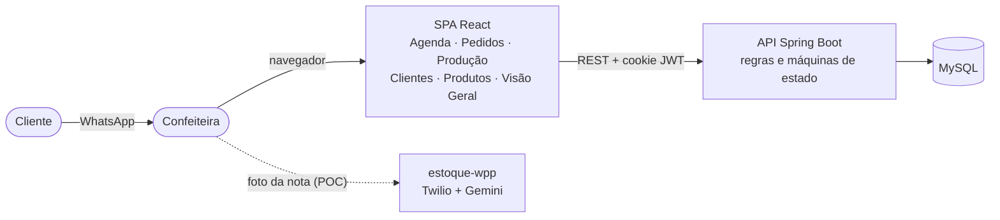

# 🍰 Doceterapia – Sistema de Gestão para Confeitaria

Documentação do sistema de **gestão de pedidos, estoque e produção** da **Doceterapia**, uma confeitaria artesanal de São Paulo.

> **Em uma frase:** a confeiteira recebe os pedidos pelo WhatsApp e controlava tudo à mão e "no olho". O sistema centraliza pedidos, agenda, clientes, produtos, insumos e pagamentos em uma aplicação web simples, com alertas de sobrecarga e de estoque e indicadores de lucro.

| | |
|---|---|
| **Para quem** | Doceterapia, confeitaria sob encomenda. Uma única usuária: a proprietária |
| **Stack** | React 19 + Vite · Java 21 + Spring Boot 4 · MySQL 8 · (prova de conceito) Node + Twilio + Gemini |
| **Repositórios** | [front-end](https://github.com/projeto-doceterapia/front-end) · [back-end](https://github.com/projeto-doceterapia/back-end) · [banco-de-dados](https://github.com/projeto-doceterapia/banco-de-dados) · [estoque-wpp](https://github.com/projeto-doceterapia/estoque-wpp) |

## 📚 Índice

| # | Seção | Conteúdo |
|---|---|---|
| 1 | [Contexto](docs/01-contexto.md) | A Doceterapia, como o negócio funciona sem o sistema, o problema e a visão geral do sistema |
| 2 | [Objetivos](docs/02-objetivos.md) | Objetivo geral, objetivos específicos, metas mensuráveis, critérios de sucesso |
| 3 | [Justificativa](docs/03-justificativa.md) | Necessidade, dores e respostas do sistema, alternativas de mercado, cenário do setor, benefícios, validação |
| 4 | [Escopo](docs/04-escopo.md) | Dentro e fora do escopo, EAP, dependências, entregáveis por sprint |
| 5 | [Requisitos](docs/05-requisitos.md) | RF01–RF13, RNF01–RNF10, histórias de usuário, critérios de aceite, rastreabilidade |
| 6 | [Premissas](docs/06-premissas.md) | Condições assumidas e impacto |
| 7 | [Restrições](docs/07-restricoes.md) | Restrições de projeto e técnicas |
| 8 | [Registro das entrevistas](docs/08-registro-entrevistas.md) | Entrevista, visita técnica, teste de usabilidade, decisões de reunião |
| 9 | [Artefatos de regra de negócio](docs/09-regras-de-negocio.md) | Catálogo, RN01–RN24, BPMN AS-IS e TO-BE, máquinas de estado, indicadores, personas |
| 10 | [Artefatos de arquitetura](docs/10-arquitetura/README.md) | Visão geral, **C4 Model**, **UML**, back-end, front-end, banco, débitos técnicos, integrações |
| 11 | [Product backlog](docs/11-product-backlog.md) | Épicos, itens priorizados (MoSCoW), situação, próximas entregas |
| 12 | [Ferramentas de planejamento](docs/12-ferramentas-de-planejamento.md) | Equipe, cronograma (Gantt), responsabilidades, rituais, status report, GTD, retrospectivas |
| 13 | [Links do projeto no Git](docs/13-links-git.md) | Repositórios, histórico, convenções, como executar |
| 14 | [Referências bibliográficas](docs/14-referencias.md) | Mercado, métodos, modelagem e tecnologias |

### Arquitetura (seção 10)

| Documento | Diagramas |
|---|---|
| [10.1 Visão geral](docs/10-arquitetura/01-visao-geral.md) | Visão em camadas, ADRs |
| [10.2 C4 Model](docs/10-arquitetura/02-c4-model.md) | Contexto, Contêineres, Componentes (API e SPA), Implantação, Dinâmico |
| [10.3 UML](docs/10-arquitetura/03-uml.md) | Casos de uso, Classes, Enumerações, Pacotes, Sequência (login, cancelamento, nota fiscal), Atividade |
| [10.4 Back-end](docs/10-arquitetura/04-back-end.md) | Endpoints, segurança JWT, erros, configuração, testes |
| [10.5 Front-end](docs/10-arquitetura/05-front-end.md) | Navegação (estados), telas, acessibilidade, CI |
| [10.6 Banco de dados](docs/10-arquitetura/06-banco-de-dados.md) | MER do `scriptv4.sql`, modelo JPA, divergências |
| [10.7 Débitos técnicos](docs/10-arquitetura/07-debitos-tecnicos.md) | 23 débitos priorizados e roteiro de correção |
| [10.8 Integrações](docs/10-arquitetura/08-integracoes.md) | Prova de conceito de WhatsApp, lacunas, arquitetura hexagonal alvo |

## 🗺️ Visão rápida da solução



## ▶️ Como executar o sistema

```bash
# Back-end (JDK 21) → http://localhost:8080 · Swagger: /swagger-ui/index.html
cd back-end && ./mvnw spring-boot:run          # Windows: .\mvnw.cmd spring-boot:run

# Front-end (Node 20+) → http://localhost:5173
cd front-end && npm ci && npm run dev           # VITE_API_URL padrão: http://localhost:8080
```

Sem configuração extra, a API usa H2 em memória. Para usar MySQL, execute `banco-de-dados/scriptv4.sql` e configure a conexão por variáveis de ambiente. Detalhes em [10.4 Back-end](docs/10-arquitetura/04-back-end.md#configuração) e [13 - Links do projeto no Git](docs/13-links-git.md#135-clonar-e-executar-tudo).

## 👥 Equipe – Grupo 9

| Integrante | Papel |
|---|---|
| Davi de Oliveira Domingues | Back-end e Integração |
| Davi Escudero Caproni | Infraestrutura e DevOps |
| Felipe Queiroz de Lima | Banco de Dados |
| Gwen Raldes de Barros | Qualidade e Regras do Sistema |
| Maria Luiza Costa Góes | Interface e Front-end · Liderança |
| Pedro Guimarães Sakaue | Produto e Documentação Técnica |

## 📝 Sobre esta documentação

- A documentação é autocontida: descreve o negócio, as regras e a arquitetura do sistema sem depender de outros materiais. Os detalhes técnicos refletem o estado atual do código.
- Os diagramas são escritos em [Mermaid](https://mermaid.js.org) e o GitHub renderiza direto. Para editar, altere o bloco ` ```mermaid ` no Markdown.
- Dados pessoais (documentos, endereço, telefone, e-mail e nomes dos participantes dos testes) foram omitidos de propósito.
- Contexto acadêmico: o sistema foi desenvolvido pelo Grupo 9 da turma 2SIS de Sistemas de Informação da São Paulo Tech School, em 2026.
- Licença: [MIT](LICENSE).
