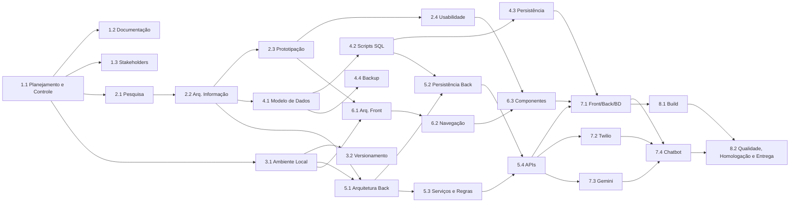

# 4. Escopo

## 4.1 Dentro do escopo

| Módulo | Funcionalidades | Situação atual |
|---|---|---|
| Gestão de pedidos | Registro manual do pedido vindo do WhatsApp, associação ao cliente, itens, entrega ou retirada, data de entrega, observações, edição e exclusão | A API está completa. A interface registra orçamentos em 3 etapas. A edição pela interface ainda não funciona |
| Agenda | Pedidos por data, farol de ocupação configurável (verde, amarelo, vermelho), identificação de dias com alta demanda | Implementado |
| Clientes | Cadastro (nome, telefone, endereço, pessoa física ou jurídica, classificação) e histórico de pedidos | Implementado |
| Produtos e ficha técnica | Catálogo por categoria, preço atual e sugerido, custo, margem e composição de insumos | Implementado |
| Estoque (insumos) | Cadastro de insumos e categorias, quantidade mínima e alerta de estoque baixo | Implementado na API. **A interface ainda não tem a tela de Estoque**: o item aparece no menu, mas não abre tela própria |
| Entrada de estoque por nota fiscal | Foto da nota fiscal pelo WhatsApp, leitura por IA e atualização automática | Implementado, em revisão (repositórios `back-end`, `assistente-whatsapp`, `infra`), ainda não implantado. Antes desta entrega: existia só na prova de conceito separada (Twilio + Gemini). Agora o assistente de estoque via WhatsApp confirma e grava os insumos no core (ver [10.9](10-arquitetura/09-assistente-visao-geral.md)) |
| Produção | Fila de produção por prazo e status | Implementado |
| Pagamentos | Sinal de 50%, restante, forma de pagamento e status | A API está completa. A interface só exibe o status |
| Cancelamentos | Motivo, tipo de retorno (crédito, devolução, sem devolução) e valor | Implementado na API |
| Indicadores (Visão Geral) | Lucro, custo, margem, dias lotados, pedidos por status, pedidos por dia, 3 produtos mais pedidos, faturamento × custo × lucro | Implementado |
| Notificações | Alertas para a usuária (estoque baixo, dia lotado, resumo de início do dia, resumo de fim do dia, compra registrada, alerta operacional) | A API cadastra as notificações, a barra superior da interface gera avisos a partir dos pedidos e o envio pelo WhatsApp está implementado e em revisão (repositórios `back-end`, `assistente-whatsapp`), ainda não implantado (ver [10.9](10-arquitetura/09-assistente-visao-geral.md)). Antes desta entrega os tipos eram estoque baixo, pedido próximo da entrega, pagamento pendente, dia lotado e atraso; os três últimos sem geração foram removidos |
| Busca | Pedidos, clientes e produtos | Busca e filtros nas telas de Produtos, Clientes, Produção e Histórico |
| Assistente de ajuda | Chatbot 24h que orienta o uso do sistema | Árvore de decisão desenhada, ainda não implementada |
| Acessibilidade | Aumento e redução da fonte, navegação por teclado, ARIA | Implementado |

## 4.2 Fora do escopo

- Compras automáticas ou qualquer outra ação no mundo externo. O sistema apoia a produção e as compras, mas não as executa.
- Substituir o WhatsApp como canal de vendas.
- Funil de vendas e captação de novos clientes. A confeiteira quer fidelizar os clientes atuais, não atrair novos.
- Loja virtual, pagamento online ou emissão de nota fiscal.
- Várias empresas ou vários perfis de usuário. Existe uma única usuária, administradora.
- Aplicativo mobile nativo. O acesso é pelo navegador, com interface responsiva entre 390 e 1440 px.

## 4.3 EAP – Estrutura Analítica do Projeto

```mermaid
flowchart TB
    R["Doceterapia"]
    R --> S["1 Software"]
    R --> D["2 Design"]
    R --> I["3 Infraestrutura"]
    R --> G["4 Gestão do Projeto"]

    S --> SF["1.1 Front-End"]
    S --> SB["1.2 Back-End"]
    S --> SI["1.3 Integração"]
    SF --> SF1["Navegação"]
    SF --> SF2["Componentes e Interface<br/>Login, Estoque, Pedidos, Produtos,<br/>Agenda, Clientes, Histórico,<br/>Visão Geral, ChatBot"]
    SF --> SF3["Arquitetura da Aplicação"]
    SB --> SB1["Arquitetura"]
    SB --> SB2["APIs"]
    SB --> SB3["Persistência e Acesso a Dados"]
    SB --> SB4["Serviços e Regras de Negócio"]
    SI --> SI1["Front / Back / BD"]
    SI --> SI2["Twilio / WhatsApp"]
    SI --> SI3["Gemini"]
    SI --> SI4["Chatbot"]

    D --> D1["Pesquisa e Levantamento"]
    D --> D2["Arquitetura da Informação"]
    D --> D3["Prototipação da Interface"]
    D --> D4["Usabilidade e Acessibilidade"]

    I --> IP["3.1 Plataforma"]
    I --> IB["3.2 Banco de Dados"]
    IP --> IP1["Ambiente Local"]
    IP --> IP2["Versionamento e Repositório"]
    IP --> IP3["Build e Execução"]
    IB --> IB1["Modelo de Dados"]
    IB --> IB2["Scripts SQL"]
    IB --> IB3["Persistência e Validação"]
    IB --> IB4["Backup e Recuperação"]

    G --> G1["Planejamento e Controle"]
    G --> G2["Documentação do Projeto"]
    G --> G3["Qualidade, Homologação e Entrega"]
    G --> G4["Relacionamento com Stakeholders"]
```

## 4.4 Dependências entre pacotes da EAP

Uma seta `A --> B` indica que B depende de A.

## 4.5 Entregáveis por sprint

| Sprint | Principais entregáveis |
|---|---|
| Sprint 1 | Proto-persona, jornada do concorrente, pesquisa de mercado, arquitetura da informação, Crazy 8s, BPMN AS-IS (processo principal e de apoio), definição de escopo |
| Sprint 2 | Métricas e KPIs, histórias de usuário, requisitos, primeira versão do banco, protótipo de alta fidelidade, visita técnica e teste de usabilidade, documentação da API e login com JWT |
| Sprint 3 | Mapeamento de endpoints, modelo de dados v4, tela de Login, acessibilidade de fonte, BPMN TO-BE, especificação dos indicadores, árvore de decisão do assistente, testes dos services |
| Sprint 4 | Arquitetura hexagonal das integrações, três telas principais integradas à API, EAP, casos de uso, critérios de aceite, métricas de qualidade, diagramas de classes e de sequência |
| Sprint 5 | Telas de Produção e Histórico, notificações e fonte acessível na interface, diagramas de contexto, contêineres e implantação, integração da prova de conceito ao banco |
| Sprint 6 | Homologação com a confeiteira, manual do usuário e entrega final |
