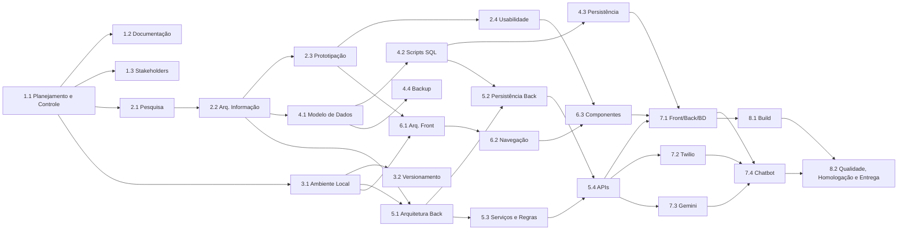

# 4. Escopo

> Fontes: `TAP2026.pdf`, `OFICIAL_DOCETERAPIA.docx`, `EAP Doceterapia.pdf`, `MATRIZ_DEPENDENCIA.xlsx`, `Status Report - Grupo 9 2SIS 2026.pptx`, código dos repositórios `front-end/` e `back-end/`.

## 4.1 Dentro do escopo

| Módulo | Funcionalidades | Situação no código (out/2026) |
|---|---|---|
| Gestão de pedidos | Registro manual do pedido vindo do WhatsApp, associação ao cliente, itens, entrega ou retirada, data de entrega, observações, edição e exclusão | Back-end completo (`/pedidos`, `/itens-pedido`). Front-end registra orçamentos em 3 etapas. A edição no front ainda não tem ação |
| Agenda | Pedidos por data, farol de ocupação (verde/amarelo/vermelho) configurável, identificação de dias com alta demanda | Implementado (`Agenda.jsx` e `/configuracao-farol`) |
| Clientes | Cadastro (nome, telefone, endereço, pessoa física ou jurídica, classificação) e histórico de pedidos | Implementado (`Clientes.jsx` e `/clientes`) |
| Produtos e ficha técnica | Catálogo por categoria, preço atual e sugerido, custo, margem e composição de insumos | Implementado (`Produtos.jsx`, `/produtos`, `/produtos/{id}/insumos`) |
| Estoque (insumos) | CRUD de insumos e categorias, quantidade mínima e alerta de estoque baixo | Back-end implementado (`/insumos`). **Não há tela de Estoque no front-end** (o menu existe sem tela) |
| Entrada de estoque por nota fiscal | Foto da nota fiscal pelo WhatsApp, leitura por IA e atualização automática | POC separada (`estoque-wpp`, Twilio + Gemini) e PRD de evolução. Ainda não integrada ao sistema |
| Produção | Fila de produção por prazo e status | Implementado (`Producao.jsx`, `/producoes`) |
| Pagamentos | Sinal de 50%, restante, forma de pagamento e status | Back-end implementado (`/pagamentos`). O front-end exibe status |
| Cancelamentos | Motivo, tipo de retorno (crédito, devolução, sem devolução) e valor | Back-end implementado (`/cancelamentos`) |
| Métricas (Visão Geral) | Lucro, custo, margem, dias lotados, pedidos por status, pedidos por dia, top 3 produtos, faturamento × custo × lucro | Implementado (`VisaoGeral.jsx`) |
| Notificações | Alertas para a usuária (estoque baixo, pedido próximo da entrega, pagamento pendente, dia lotado, atraso) | Back-end com CRUD (`/notificacoes`). A topbar do front-end gera avisos a partir dos pedidos. O envio por WhatsApp está planejado |
| Busca | Pedidos, clientes e produtos | Busca local nas telas de Produtos, Clientes e Histórico |
| Assistente (chatbot) | Chatbot 24h de ajuda ao uso | Árvore de decisão desenhada (Botpress). Não implementado |
| Acessibilidade | Aumento e redução de fonte, navegação por teclado, ARIA | Implementado (`AppTopbar.jsx`) |

## 4.2 Fora do escopo

- Compras automáticas ou qualquer ação ativa no mundo externo. O sistema não substitui a produção nem as compras reais (TAP, restrições).
- Substituir o WhatsApp como canal de vendas. Ele continua sendo o canal principal.
- Funil de vendas e captação de clientes (Pipefy). Foi descartado na Semana 5 porque a beneficiária não quer mais clientes, só fidelizar os atuais.
- Loja virtual, pagamento online ou emissão fiscal.
- Múltiplas empresas ou usuários com perfis diferentes. O sistema tem uma única usuária administradora.
- Aplicativo mobile nativo.

> **Divergência entre fontes:** o TAP define o acesso "exclusivamente via navegador de computador", enquanto o documento oficial e o RNF02 citam celular e computador. Os critérios de aceite resolvem a diferença exigindo interface responsiva entre 390 e 1440 px.

## 4.3 EAP – Estrutura Analítica do Projeto

```mermaid
flowchart TB
    R["Doceterapia"]
    R --> S["1 Software"]
    R --> D["2 Design"]
    R --> I["3 Infraestrutura"]
    R --> G["4 Gestão do Projeto"]

    S --> SF["1.1 Front-End"]
    S --> SB["1.2 Back-End"]
    S --> SI["1.3 Integração"]
    SF --> SF1["Navegação"]
    SF --> SF2["Componentes e Interface<br/>Login, Estoque, Pedidos, Produtos,<br/>Agenda, Clientes, Histórico,<br/>Visão Geral, ChatBot"]
    SF --> SF3["Arquitetura da Aplicação"]
    SB --> SB1["Arquitetura"]
    SB --> SB2["APIs"]
    SB --> SB3["Persistência e Acesso a Dados"]
    SB --> SB4["Serviços e Regras de Negócio"]
    SI --> SI1["Front / Back / BD"]
    SI --> SI2["Twilio / WhatsApp"]
    SI --> SI3["Gemini"]
    SI --> SI4["Chatbot"]

    D --> D1["Pesquisa e Levantamento"]
    D --> D2["Arquitetura da Informação"]
    D --> D3["Prototipação da Interface"]
    D --> D4["Usabilidade e Acessibilidade"]

    I --> IP["3.1 Plataforma"]
    I --> IB["3.2 Banco de Dados"]
    IP --> IP1["Ambiente Local"]
    IP --> IP2["Versionamento e Repositório"]
    IP --> IP3["Build e Execução"]
    IB --> IB1["Modelo de Dados"]
    IB --> IB2["Scripts SQL"]
    IB --> IB3["Persistência e Validação"]
    IB --> IB4["Backup e Recuperação"]

    G --> G1["Planejamento e Controle"]
    G --> G2["Documentação do Projeto"]
    G --> G3["Qualidade, Homologação e Entrega"]
    G --> G4["Relacionamento com Stakeholders"]
```

## 4.4 Dependências entre pacotes da EAP

Extraído da `MATRIZ_DEPENDENCIA.xlsx`. Uma seta `A --> B` significa que B depende de A.

## 4.5 Entregáveis por sprint

| Sprint | Principais entregáveis |
|---|---|
| Sprint 1 (fev–mar/2026) | Documento de Condução, troca de beneficiária, proto-persona, jornada do concorrente, relatório Elevator Pitch, Arquitetura da Informação e UX Writing, Crazy 8s, BPMN AS-IS (primário e de apoio), definição de escopo e ODS, apresentação em 17/03 |
| Sprint 2 (mar–mai/2026) | Métricas e KPIs, histórias de usuário, RF/RNF, BD v2 e script, protótipo de alta fidelidade no Figma, visita técnica (12/04), teste de usabilidade, Swagger e login com JWT, programas de fidelidade |
| Sprint 3 (mai–jun/2026) | Mapeamento de endpoints, modelagem v4, tela de Login, protótipo com acessibilidade de fonte, BPMN TO-BE, especificação de métricas do dashboard, árvore de decisão do bot, testes de service no back-end |
| Sprint 4 (ago–set/2026) | Arquitetura hexagonal da POC de notificação, 3 telas core integradas ao back-end, TAP, EAP, diagrama de casos de uso, critérios de aceitação, métricas de qualidade, diagrama de classes, diagrama de sequência |
| Sprint 5 (set–out/2026) | Consultoria cruzada (Grupo 1), 2 novas telas (Produção e Histórico), diagramas de contexto, contêiner e implantação, integração da POC ao banco, notificações e fonte acessível no front |
| Sprint 6 (out–dez/2026) | Homologação, manual, relatório final e entrega (prazo final em 08/12/2026) |
