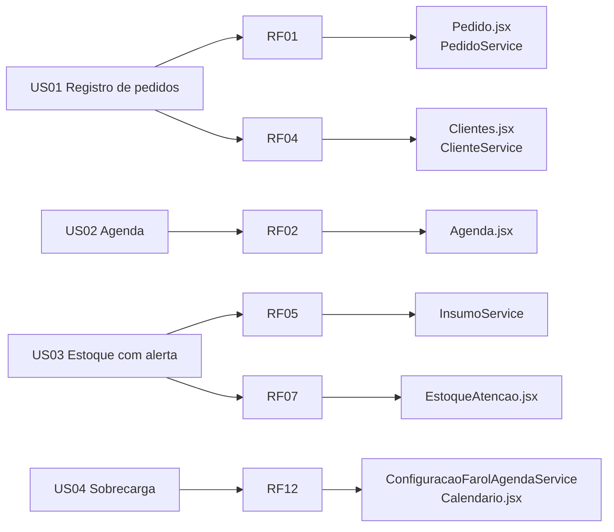

# 5. Requisitos

> Fontes: `REQUISITOS FUNCIONAIS E NÃO FUNCIONAIS - DOCETERAPIA.pdf`, `User Stories - Doceterapia.pdf`, `DoceTerapia_Criterios_de_Aceite.pptx`, `Atividade - Critérios de Aprovação e Métricas (1).pdf`, `RELATORIO_VISITA_TECNICA.docx`. A coluna "Situação" foi verificada no código em out/2026.

Legenda: ✅ atendido · 🟡 parcial · ⛔ não iniciado

## 5.1 Requisitos funcionais

| ID | Requisito | Descrição | Situação | Evidência no código |
|---|---|---|---|---|
| RF01 | Cadastro de pedidos | Registro manual de pedidos do WhatsApp: cliente, data de entrega, produtos e observações | ✅ | `Pedido.jsx` (3 etapas), `POST /pedidos`, `POST /itens-pedido` |
| RF02 | Agenda de pedidos | Pedidos organizados por data, em lista ou calendário | ✅ | `Agenda.jsx` (calendário mensal com farol) |
| RF03 | Edição e exclusão de pedidos | Alterar e remover pedidos | 🟡 | `PUT`/`DELETE /pedidos/{id}` existem. No front, o botão de editar do histórico não tem ação e não há exclusão |
| RF04 | Cadastro de clientes | Nome, telefone e endereço | ✅ | `Clientes.jsx`, `/clientes` (telefone único) |
| RF05 | Controle de estoque (CRUD) | Cadastrar, consultar, alterar e remover insumos | 🟡 | `/insumos` e `/categorias-insumo` completos. Não há tela de Estoque |
| RF06 | Atualização de estoque | Entradas e saídas com atualização automática das quantidades | ⛔ | Não há baixa automática na produção. A entrada por nota fiscal está só na POC `estoque-wpp` |
| RF07 | Alerta de baixo estoque | Avisar quando o insumo fica abaixo do mínimo | 🟡 | `EstoqueAtencao.jsx` calcula `quantidadeAtual <= quantidadeMinima`. O tipo `ESTOQUE_BAIXO` existe, mas não é gerado automaticamente |
| RF08 | Verificação de disponibilidade | Informar se é possível produzir um pedido com o estoque atual | ⛔ | A ficha técnica (`produto_insumo`) existe, mas o cálculo não foi implementado |
| RF09 | Histórico de movimentações de estoque | Registro de entradas e saídas | ⛔ | Não há entidade de movimentação |
| RF10 | Pesquisa | Buscar pedidos, clientes e estoque por filtros | 🟡 | Busca e filtros locais em Produtos, Clientes, Produção e Histórico |
| RF11 | Log de pedidos | Registrar criação, edição e exclusão | ⛔ | Os triggers de auditoria foram iniciados (Semana 2), mas não estão no `scriptv4.sql` |
| RF12 | Alerta de sobrecarga | Avisar quando há muitos pedidos no mesmo dia | ✅ | Farol da agenda (`ConfiguracaoFarolAgenda`) e card "Dias lotados" |
| RF13 | Métricas | Lucro e ocorrências de falta de ingredientes | 🟡 | Lucro, custo, margem e dias lotados prontos. As ocorrências de falta ainda não são registradas |

## 5.2 Requisitos não funcionais

| ID | Categoria | Descrição | Como é tratado |
|---|---|---|---|
| RNF01 | Usabilidade | Interface simples para usuária com pouco conhecimento técnico | Fluxo em etapas, poucos campos e testes de usabilidade com 5 participantes |
| RNF02 | Acessibilidade | Uso em mobile e desktop, responsivo | Media queries (760 px e 480 px), escala de fonte de 1 a 1,8×, ARIA e HTML semântico |
| RNF03 | Desempenho | Operações comuns em menos de 2 s | Sem medição formal até o momento |
| RNF04 | Confiabilidade | Integridade dos dados | Bean Validation, FKs, `CHECK` e `UNIQUE` no MySQL, `BigDecimal` para dinheiro |
| RNF05 | Disponibilidade | Disponível sobretudo em horário comercial | Implantação local (C4 Deployment). Meta de 99,9% para a mensageria |
| RNF06 | Segurança | Acesso só para usuários autorizados | JWT em cookie HttpOnly e BCrypt. **Hoje as rotas de domínio estão liberadas** (ver [débitos técnicos](10-arquitetura/07-debitos-tecnicos.md)) |
| RNF07 | Simplicidade operacional | Mínimo de etapas por tarefa | Navegação lateral e atalhos "Novo pedido" |
| RNF08 | Manutenibilidade | Código modular | Camadas controller/service/repository, DTOs, mappers e contratos OpenAPI |
| RNF09 | Escalabilidade | Evoluir com novos módulos e integração com WhatsApp | API REST desacoplada. POC de WhatsApp em serviço separado |
| RNF10 | Clareza | Listas, alertas e indicadores diretos | Cards de resumo, farol de cores e status em linguagem natural |

## 5.3 Histórias de usuário

As histórias seguem o formato INVEST. O teste de aceitação de cada uma está entre parênteses.

| ID | História | Teste | RFs |
|---|---|---|---|
| US01 | **Registro simples de pedidos.** Como confeiteira, quero registrar no sistema os pedidos que recebo pelo WhatsApp, para organizar melhor as informações e não depender apenas da conversa. | Registrar um pedido e verificar se ele foi salvo | RF01, RF04 |
| US02 | **Agenda de pedidos.** Como confeiteira, quero ver todos os pedidos organizados por data, para planejar melhor minha produção diária. | Os pedidos aparecem na data correta | RF02 |
| US03 | **Estoque com alerta.** Como confeiteira, quero saber quando os ingredientes estão acabando, para não faltar nada na hora de produzir. | Reduzir o estoque e verificar o alerta | RF05, RF07 |
| US04 | **Alerta de sobrecarga.** Como confeiteira, quero ser avisada quando tiver muitos pedidos em um dia, para evitar sobrecarga e problemas na entrega. | Inserir pedidos acima do limite e verificar o alerta | RF12 |

## 5.4 Critérios de aceite do projeto

| # | Dimensão | Critério | Evidência exigida |
|---|---|---|---|
| 01 | Fluxo principal | Nota fiscal enviada pelo WhatsApp é processada e os insumos são cadastrados corretamente | Teste ponta a ponta com retorno do bot e registro no banco |
| 02 | Desempenho | Inserção por foto em até 15 s e OCR com 100% de acerto nos campos obrigatórios de notas legíveis | Cronômetro e amostra de notas válidas |
| 03 | Regras de negócio | Alerta de estoque baixo, sinalização de excesso de pedidos e bloqueio da confirmação quando faltam insumos | Casos de teste com mensagens e quantidades |
| 04 | Disponibilidade | Mensageria com uptime de 99,9%, sem mensagens perdidas | Monitoramento e logs |
| 05 | Recuperação | Falhas críticas detectadas, corrigidas e restauradas em até 12 h. MTBF projetado de 6 meses | Registro de incidente, causa e tempo de restauração |
| 06 | Uso e suporte | Interface responsiva em desktop e chatbot 24h | Roteiro de usabilidade e teste entre 390 e 1440 px |

## 5.5 Critérios de aprovação (Pesquisa e Inovação)

- **Gestão e funcionalidades:** processar fotos de nota fiscal e cadastrar insumos (WhatsApp, Twilio e Gemini); alertas automáticos de estoque baixo e de excesso de pedidos no mesmo dia; verificação de viabilidade no registro manual. Frequência: rotina diária.
- **Suporte:** 100% de compatibilidade com navegadores mobile e desktop; execução inteira na web com correções centralizadas até o fim do 2º semestre de 2026; chatbot 24h na web e no mobile.

## 5.6 Requisitos levantados na visita técnica e no teste de usabilidade

| ID | Requisito | Origem | Situação |
|---|---|---|---|
| RV01 | Simplificar ao máximo a interface | Visita técnica | Contínuo |
| RV02 | Reduzir campos obrigatórios | Visita técnica | 🟡 |
| RV03 | Destacar visualmente os alertas importantes | Visita técnica | ✅ farol e cards |
| RV04 | Organizar melhor a visão dos pedidos | Visita técnica | ✅ telas de Produção e Histórico |
| RV05 | Botão de edição de pedido claro | Teste de usabilidade | 🟡 ícone presente, sem ação |
| RV06 | Separar "novo cliente" de "cliente existente" | Teste de usabilidade | ✅ etapa 1 do pedido |
| RV07 | Mostrar valor total, sinal e restante | Teste de usabilidade | ✅ `Pagamento.jsx`, `ResumoPedido.jsx` |
| RV08 | Status intermediário entre "aguardando pagamento" e "em produção" | Teste de usabilidade | ✅ `ESPERANDO_FAZER` |
| RV09 | Fontes maiores e menos poluição visual | Teste de usabilidade | ✅ controle de fonte |

## 5.7 Rastreabilidade

