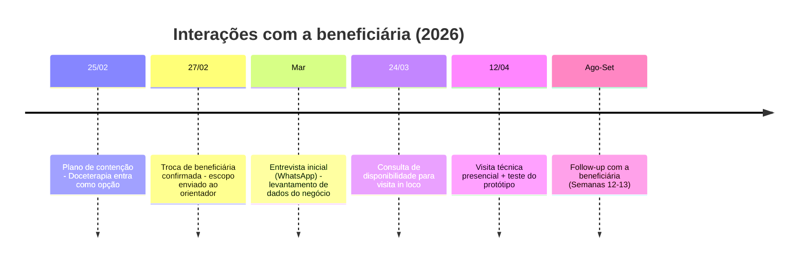

# 8. Registro das entrevistas

> Fontes: `Projeto de Extensão/Beneficiário/{Perguntas.txt, Anotações - Beneficiário.txt, RELATORIO_VISITA_TECNICA.docx}`, `Matérias/UX/{UX - Testes de Usabilidade - Entregável PI.docx, Teste de Usabilidade - Doceterapia (respostas).xlsx}`, `Atas Reuniões/*.docx`, `Status Report - Grupo 9 2SIS 2026.pptx`.
>
> Por privacidade, os participantes externos dos testes aparecem como P1 a P5. Contatos e endereços da beneficiária foram omitidos.

## 8.1 Linha do tempo de contato com a beneficiária

## 8.2 Entrevista inicial (levantamento de dados)

**Formato:** conversa remota com a proprietária, conduzida por Davi Domingues (responsável pelo relacionamento com a beneficiária).
**Objetivo:** mapear as áreas do negócio que o sistema poderia atender.

| Tópico (roteiro) | Resposta registrada |
|---|---|
| Foco do negócio | Empresas e grandes demandas |
| Compras | Monta uma lista de compras e compra quando o item "está acabando no armário" |
| Vendas / pedidos | O cliente chama pelo WhatsApp, muitas vezes vindo do Instagram. O pedido é anotado na agenda, na data de entrega. A base é de clientes fiéis |
| Controle de estoque | Não existe controle formal |
| Financeiro | Quer um "dash financeiro" |

**Resultado:** as cinco áreas (compras, vendas, estoque, sistema de pedidos e dashboard financeiro) viraram os módulos iniciais do escopo.

## 8.3 Visita técnica (12/04/2026)

| Item | Registro |
|---|---|
| Local | Residência e ateliê da beneficiária, Interlagos, São Paulo/SP |
| Participantes | Os 6 integrantes do Grupo 9, a proprietária e a ajudante |
| Objetivos | Entender o negócio real, validar hipóteses, identificar problemas e avaliar a usabilidade do protótipo |
| Metodologia | Observação direta do processo e teste de usabilidade do protótipo de alta fidelidade (Figma) |
| Relatório | Escrito por Pedro Sakaue a partir das anotações do time (Semana 4) |

### 8.3.1 Processo observado

O cliente entra em contato pelo WhatsApp, e a proprietária negocia produto, quantidade e data. Depois ela anota o pedido à mão, compra os ingredientes com base na própria percepção, produz conforme as anotações e entrega na data combinada. O BPMN deste processo está em [09 - Regras de negócio](09-regras-de-negocio.md#93-processo-as-is-bpmn).

### 8.3.2 Achados por tema

O nível de ênfase reproduz as marcações de intensidade da própria beneficiária nas anotações.

| Tema | Achado | Ênfase |
|---|---|---|
| Organização | Processo totalmente manual, com anotações por palavras-chave. Consome muito tempo e fica desorganizado pela falta de tempo e pelo excesso de demanda | — |
| Pedidos | Pedidos de última hora, inclusive para o mesmo dia | ★★ |
| Pedidos | Pedidos de grande volume (milhares de unidades) | ★★ |
| Pedidos | Aceita pedidos sem verificar os insumos | ★★ |
| Pedidos | Tem dificuldade de recusar pedidos por causa do relacionamento com o cliente, o que gera sobrecarga | ★★ |
| Produção | O preparo de insumos (doces base) é a etapa crítica. O processo tem várias etapas, depende de tempo e envolve itens perecíveis | ★★ |
| Estoque | Controle "no olho", com erros frequentes de percepção e sem validação antes de confirmar o pedido | ★★ |
| Receitas | Existem só na memória, sem padronização | ★★ |
| Precificação | Preço definido "no achismo", sem custo real nem margem, com risco de prejuízo. É a **principal dor** | ★★★★★ |
| Financeiro | Precisa de controle básico de entradas e saídas e de preço sugerido | ★★ |
| Clientes | Relação forte, mas o histórico (inclusive de pagamentos) depende da memória | — |
| Cancelamento | Regra consolidada do sinal de 50%. Reaproveita o produto ou converte o valor em crédito | ★★★ |
| Demanda | Volátil, com sobrecarga recorrente | ★★ |
| UI/UX | Dificuldade para achar botões, fonte pequena, pede botões claros ("criar pedido", "criar cliente") | — |

### 8.3.3 Feedback sobre o protótipo e decisões tomadas

| Feedback | Decisão |
|---|---|
| O sistema precisa ser muito simples e direto | Fluxo em etapas e poucos campos obrigatórios |
| Telas com muitos campos geram dificuldade | Reduzir os campos do pedido |
| Elementos visuais ajudam | Farol de cores na agenda e cards de resumo |
| O sistema deve complementar o WhatsApp, não substituí-lo | O WhatsApp continua como canal. A integração fica só para notificações e entrada de estoque |
| Evitar termos técnicos | Status em linguagem natural ("Aguardando sinal", "Esperando fazer") |
| Valoriza alertas de estoque e de organização | Alertas de estoque baixo e de dias lotados entram na Visão Geral |

**Riscos levantados:** resistência ao uso, dados registrados de forma incorreta ou incompleta e abandono se a ferramenta ficar complexa.
**Próximos passos definidos:** refinar e simplificar o protótipo, implementar o essencial (pedidos, estoque e alertas) e fazer novos testes.

## 8.4 Teste de usabilidade (abr/2026)

**Escopo:** módulo de Pedidos (Registrar Pedido e Histórico) no protótipo navegável.
**Participantes:** 5 pessoas de fora da área de TI, de 42 a 56 anos, incluindo professora, assistente operacional e diarista. Todos incorporaram a proto-persona da confeiteira.

### 8.4.1 Tarefas e tempos

Dificuldade percebida em escala de 1 (fácil) a 5 (difícil).

| Tarefa | Meta | P1 | P2 | P3 | P4 | P5 | Média | Dificuldade média |
|---|---|---|---|---|---|---|---|---|
| T1 Registrar novo pedido para cliente existente | 60 s | 12 s | 64 s | 139 s | 240 s | 120 s | **115 s** | 2,0 |
| T2 Editar pedido (status e data de entrega) | 30 s | 15 s | 100 s | 100 s | 180 s | 70 s | **93 s** | 3,2 |
| T3 Encontrar os próximos pedidos a produzir | 20 s | 7 s | 30 s | 84 s | 240 s | 90 s | **90 s** | 2,4 |

### 8.4.2 Questionário

| Pergunta | Sim | Não / com dificuldade |
|---|---|---|
| 1. Identificou com facilidade onde registrar um novo pedido? | 5 | 0 (1 confundiu novo pedido com novo cliente) |
| 2. O processo de adicionar informações pareceu claro? | 4 | 1 ("mais ou menos") |
| 3. Foi fácil localizar os pedidos a produzir? | 3 | 2 |
| 4. Entendeu em que etapa cada pedido estava? | 4 (1 com ressalva: "não foi intuitivo") | 1 |
| 5. Foi fácil encontrar e editar um pedido no histórico? | **1** | **4** |
| 6. A interface parece simples e intuitiva no geral? | 5 | 0 |

### 8.4.3 Achados e melhorias aplicadas

| Achado | Melhoria | Situação no código |
|---|---|---|
| A edição de pedido não foi encontrada (problema mais crítico) | Ícone de edição (caneta) claro | 🟡 ícone em `TabelaHistoricoPedidos.jsx`, ainda sem ação |
| "Histórico" foi entendido como lista de pedidos passados | Tela própria de **Produção** no submenu Pedidos | ✅ `Producao.jsx` |
| "Etapa" não foi associada a status | Rótulos de status em linguagem natural | ✅ `pedidoUtils.js` |
| Falta um status entre "aguardando pagamento" e "em produção" | Status `ESPERANDO_FAZER` ("Aguardando produção") | ✅ `StatusPedido` |
| Confusão entre novo cliente e cliente existente | Escolha explícita na etapa 1 | ✅ `Pedido.jsx` |
| Sinal de 50% aparece sem o valor total | Exibir total, sinal e restante | ✅ `Pagamento.jsx`, `ResumoPedido.jsx` |
| Erros de preenchimento pouco evidentes | Mensagens de validação por etapa | ✅ `Pedido.jsx` |
| Fonte pequena e excesso de cores | Controle de fonte (1× a 1,8×) e paleta revisada | ✅ `AppTopbar.jsx`, `theme.css` |

## 8.5 Atas de reunião da equipe

| # | Data | Tipo / formato | Ausentes | Pauta | Decisões e encaminhamentos |
|---|---|---|---|---|---|
| 01 | 06/02/2026 | Team Building, online (Discord) | — | Documento de objetivos e regras, Team Building e Retrospective, escolha de beneficiária, liderança, modelagem de processos, documento individual de PI, branding | Documento de Condução redigido. Três opções de beneficiária mantidas. Liderança de Maria Luiza com Davi Domingues de suplente. Entrega de 2 das 3 modelagens |
| 02 | 20/02/2026 | Weekly, online | Maria Luiza | Comunicação com a beneficiária, proto-persona (UX), questionário de produtividade | E-mails com a beneficiária conduzidos por Davi Domingues. Proto-persona entregue. Pedro envia as dúvidas ao orientador |
| 03 | 25/02/2026 | Daily, presencial (SPTech) | — | Plano de contenção: troca de beneficiária | Três opções avaliadas: bazar (doadores), pet shop (agendamentos) e **confeitaria** (pedidos, estoque e dashboard financeiro, com ressalva sobre a distância) |
| 04 | 27/02/2026 | Weekly, online | — | Proto-persona, jornada do concorrente, Elevator Pitch, Arquitetura da Informação, Crazy 8s, BPMN AS-IS, escopo, ODS | Crazy 8s com relatório de Felipe e Escudero. BPMN AS-IS com Davi e Gwen. Escopo e ODS enviados ao orientador. E-mails de encerramento enviados à Nosso Lar e aos demais prospectos |
| 05 | 06/03/2026 | Weekly, online | Gwen | Estrutura do Planner, artefatos, apresentação da Sprint 1 | Ensaios presenciais em 10/03 e 16/03. Apresentação em 17/03 |
| 06 | 13/03/2026 | Weekly, online | Felipe | Conferência de entregáveis, slides, falas, ensaio | Preparação final da Sprint 1 |
| 07 | 27/03/2026 | Weekly, online | Escudero, Gwen | Feedbacks da retrospective, data da visita técnica, coleta de dados (MP), checagem de tasks | Visita técnica marcada para depois da Páscoa |
| 08 | 10/04/2026 | Weekly, online | Gwen | Funil de vendas (Pipefy), teste de usabilidade, validação do front com o back e o BD, programação da visita | Roteiro da visita e do teste fechados para 12/04 |

## 8.6 Follow-ups

- **Semana 5 (11/05):** a beneficiária disse que não quer captar novos clientes, só fidelizar os atuais. Com isso, o funil de vendas no Pipefy foi descartado.
- **Semanas 12–13 (ago–set):** meeting de follow-up com a beneficiária (responsável: Davi Domingues) para acompanhar a evolução das telas integradas.
