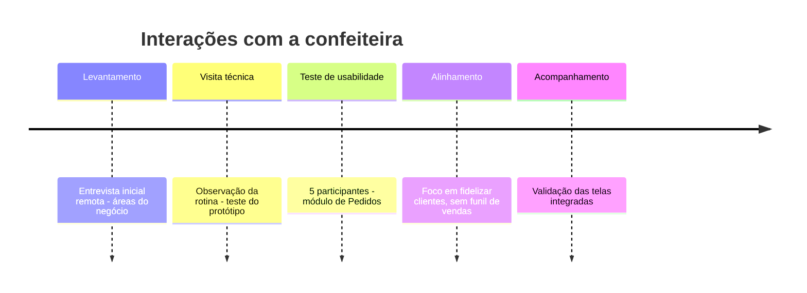

# 8. Registro das entrevistas

Esta seção reúne o que foi levantado diretamente com a confeiteira (entrevista e visita técnica) e com usuários de teste (teste de usabilidade), além das decisões de reunião que afetaram o sistema. Por privacidade, os participantes do teste aparecem como P1 a P5, e os dados de contato da confeiteira foram omitidos.

## 8.1 Linha do tempo das interações com a confeiteira

## 8.2 Entrevista inicial

**Formato:** conversa remota com a proprietária.
**Objetivo:** mapear as áreas do negócio que o sistema poderia atender.

| Tópico | Resposta registrada |
|---|---|
| Foco do negócio | Empresas e grandes demandas |
| Compras | Monta uma lista e compra quando o item "está acabando no armário" |
| Vendas e pedidos | O cliente chama pelo WhatsApp, muitas vezes vindo do Instagram. O pedido é anotado na agenda, na data de entrega. A base é de clientes fiéis |
| Controle de estoque | Não existe controle formal |
| Financeiro | Quer um "dash financeiro" |

**Resultado:** as cinco áreas (compras, vendas, estoque, pedidos e painel financeiro) viraram os módulos iniciais do sistema.

## 8.3 Visita técnica

| Item | Registro |
|---|---|
| Quando | Abril de 2026 |
| Local | Ateliê da confeiteira, em Interlagos, São Paulo/SP |
| Participantes | Equipe de desenvolvimento, a proprietária e a ajudante |
| Objetivos | Entender a rotina real, validar hipóteses, identificar problemas e avaliar a usabilidade do protótipo |
| Método | Observação direta do processo e teste do protótipo de alta fidelidade |

### 8.3.1 Processo observado

O cliente entra em contato pelo WhatsApp, e a proprietária negocia produto, quantidade e data. Depois ela anota o pedido à mão, compra os ingredientes com base na própria percepção, produz conforme as anotações e entrega na data combinada. Esse processo está modelado em [09 - Regras de negócio](09-regras-de-negocio.md#93-processo-as-is-bpmn).

### 8.3.2 Achados por tema

A coluna Ênfase reproduz a intensidade que a própria confeiteira deu a cada ponto.

| Tema | Achado | Ênfase |
|---|---|---|
| Organização | Processo totalmente manual, com anotações por palavras-chave. Consome muito tempo e fica desorganizado pela falta de tempo e pelo excesso de demanda | — |
| Pedidos | Pedidos de última hora, inclusive para o mesmo dia | ★★ |
| Pedidos | Pedidos de grande volume (milhares de unidades) | ★★ |
| Pedidos | Aceita pedidos sem verificar os insumos | ★★ |
| Pedidos | Tem dificuldade de recusar pedidos por causa do relacionamento com o cliente, o que gera sobrecarga | ★★ |
| Produção | O preparo dos insumos-base é a etapa crítica. O processo tem várias etapas, depende de tempo e envolve itens perecíveis | ★★ |
| Estoque | Controle "no olho", com erros frequentes de percepção e sem validação antes de confirmar o pedido | ★★ |
| Receitas | Existem só na memória, sem padronização | ★★ |
| Precificação | Preço definido "no achismo", sem custo real nem margem, com risco de prejuízo. É a **principal dor** | ★★★★★ |
| Financeiro | Precisa de controle básico de entradas e saídas e de preço sugerido | ★★ |
| Clientes | Relação forte, mas o histórico (inclusive de pagamentos) depende da memória | — |
| Cancelamento | Regra consolidada do sinal de 50%. Reaproveita o produto ou converte o valor em crédito | ★★★ |
| Demanda | Volátil, com sobrecarga recorrente | ★★ |
| Interface | Dificuldade para achar botões e fonte pequena. Pede botões claros ("criar pedido", "criar cliente") | — |

### 8.3.3 Feedback sobre o protótipo e decisões tomadas

| Feedback | Decisão |
|---|---|
| O sistema precisa ser muito simples e direto | Fluxo em etapas e poucos campos obrigatórios |
| Telas com muitos campos geram dificuldade | Reduzir os campos do pedido |
| Elementos visuais ajudam | Farol de cores na agenda e cards de resumo |
| O sistema deve complementar o WhatsApp, não substituí-lo | O WhatsApp continua como canal. A integração fica só para notificações e entrada de estoque |
| Evitar termos técnicos | Status em linguagem natural ("Aguardando sinal", "Esperando fazer") |
| Alertas de estoque e de organização são valorizados | Alertas de estoque baixo e de dias lotados entram na Visão Geral |

**Riscos levantados:** resistência ao uso, dados registrados de forma incorreta ou incompleta e abandono do sistema se ele ficar complexo.
**Próximos passos:** simplificar o protótipo, implementar o essencial (pedidos, estoque e alertas) e fazer novos testes.

## 8.4 Teste de usabilidade

**Escopo:** módulo de Pedidos (Registrar Pedido e Histórico) no protótipo navegável.
**Participantes:** 5 pessoas de fora da área de tecnologia, de 42 a 56 anos (entre elas uma professora, uma assistente operacional e uma diarista). Todas fizeram as tarefas no papel da confeiteira.

### 8.4.1 Tarefas e tempos

Dificuldade percebida em escala de 1 (fácil) a 5 (difícil).

| Tarefa | Meta | P1 | P2 | P3 | P4 | P5 | Média | Dificuldade média |
|---|---|---|---|---|---|---|---|---|
| T1 Registrar novo pedido para cliente existente | 60 s | 12 s | 64 s | 139 s | 240 s | 120 s | **115 s** | 2,0 |
| T2 Editar pedido (status e data de entrega) | 30 s | 15 s | 100 s | 100 s | 180 s | 70 s | **93 s** | 3,2 |
| T3 Encontrar os próximos pedidos a produzir | 20 s | 7 s | 30 s | 84 s | 240 s | 90 s | **90 s** | 2,4 |

### 8.4.2 Questionário

| Pergunta | Sim | Não ou com dificuldade |
|---|---|---|
| 1. Identificou com facilidade onde registrar um novo pedido? | 5 | 0 (1 confundiu novo pedido com novo cliente) |
| 2. O processo de adicionar informações pareceu claro? | 4 | 1 ("mais ou menos") |
| 3. Foi fácil localizar os pedidos a produzir? | 3 | 2 |
| 4. Entendeu em que etapa cada pedido estava? | 4 (1 com ressalva: "não foi intuitivo") | 1 |
| 5. Foi fácil encontrar e editar um pedido no histórico? | **1** | **4** |
| 6. A interface parece simples e intuitiva no geral? | 5 | 0 |

### 8.4.3 Achados e melhorias aplicadas

| Achado | Melhoria | Situação |
|---|---|---|
| A edição de pedido não foi encontrada (problema mais crítico) | Ícone de edição (caneta) visível | 🟡 o ícone existe no Histórico, mas ainda não tem ação |
| "Histórico" foi entendido como lista de pedidos passados | Tela própria de **Produção** no submenu Pedidos | ✅ |
| "Etapa" não foi associada a status | Rótulos de status em linguagem natural | ✅ |
| Faltava um status entre "aguardando pagamento" e "em produção" | Status "Esperando fazer" (`ESPERANDO_FAZER`) | ✅ |
| Confusão entre novo cliente e cliente existente | Escolha explícita na primeira etapa do pedido | ✅ |
| Sinal de 50% aparecia sem o valor total | Exibir total, sinal e restante | ✅ |
| Erros de preenchimento pouco evidentes | Mensagens de validação em cada etapa | ✅ |
| Fonte pequena e excesso de cores | Controle de fonte (1× a 1,8×) e paleta revisada | ✅ |

## 8.5 Decisões de reunião que afetaram o sistema

| Momento | Decisão |
|---|---|
| Definição do escopo inicial | Pedidos, estoque e painel financeiro como núcleo do sistema |
| Modelagem do processo | Mapear em BPMN o processo atual de pedido e produção e o processo de compra de insumos |
| Planejamento da visita | Visita técnica combinada com o teste do protótipo, com roteiro de observação e tarefas |
| Validação da integração | Conferir se a interface conversa corretamente com a API e o banco antes do teste com usuários |
| Alinhamento com a confeiteira | Ela não quer atrair novos clientes, só fidelizar os atuais. O funil de vendas foi descartado e a fidelização ficou na classificação de clientes |
| Acompanhamento | Reuniões de acompanhamento com a confeiteira para validar as telas conforme foram integradas |
