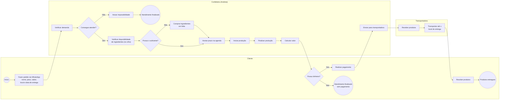
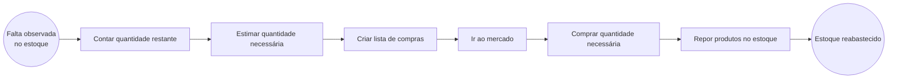
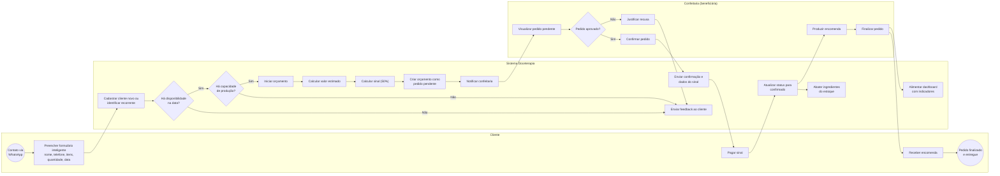
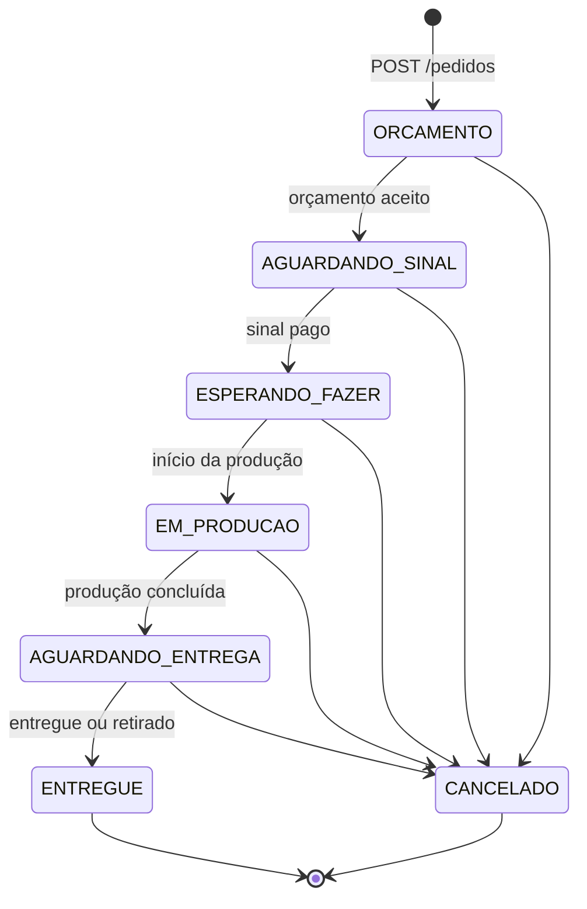
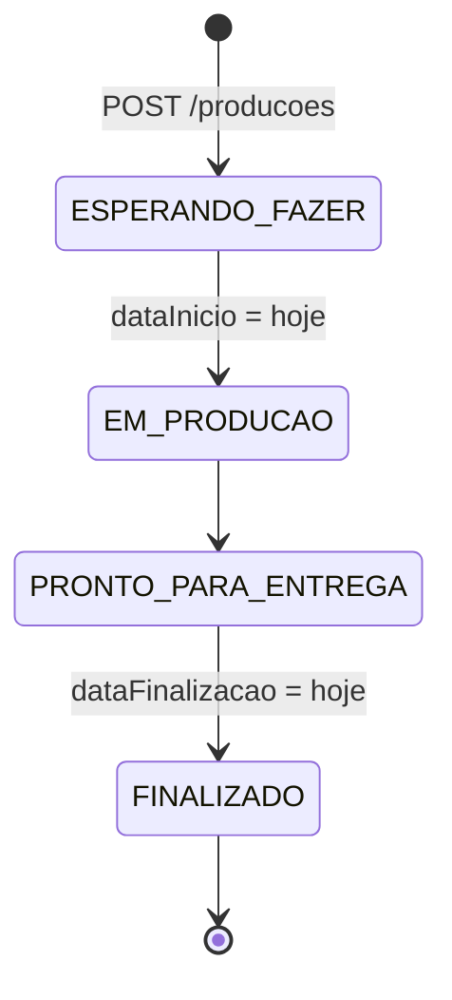
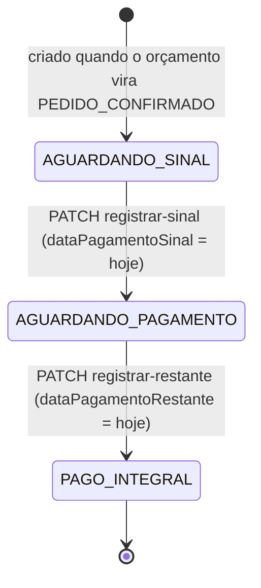
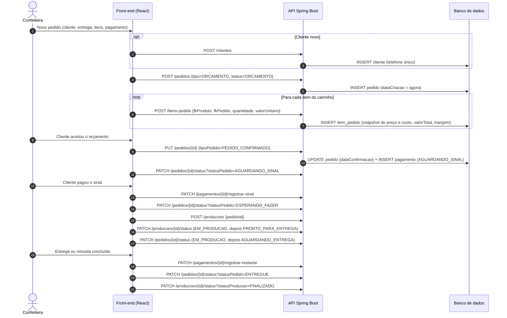
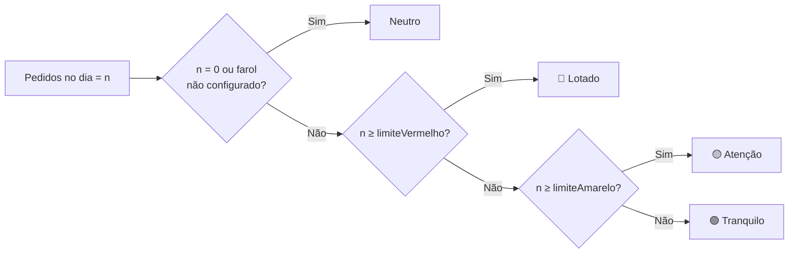
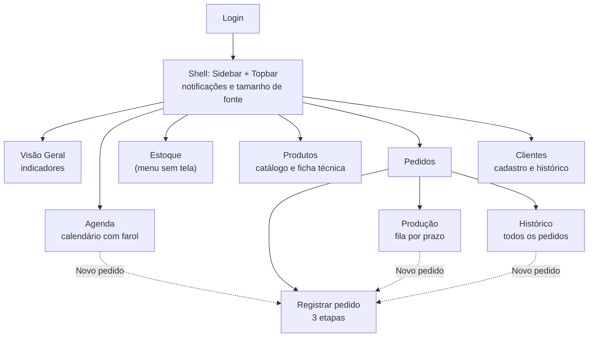

# 9. Artefatos de regra de negócio

> Fontes: `Cardápio de bolos ... .pdf`, `_Portfólio Doceterapia (4).pdf`, `Anotações - Beneficiário.txt`, `Processos do Beneficiário - BPMN.drawio`, `ATIVIDADE_02_MP_GRUPO_09.docx`, `ATIVIDADE_06_MP_GRUPO_09.docx`, `Diagrama Processo Beneficiaria Automatizado - Grupo 9 (1).svg`, `Especificacao_metricas.txt`, `UX - Aula 4/5`, `SIS - PROTO-PERSONA e JORNADA DO CONCORRENTE.pptx`, `ATIVIDADE_03_PF_GRUPO_09.docx`. O comportamento implementado foi verificado em `back-end/src/main/java/br/com/doceterapia/api/service/*` e `front-end/src/**`.

## 9.1 Catálogo e preços praticados

Cardápio vigente da beneficiária. Ele serve de referência para o cadastro de produtos e categorias.

| Categoria | Item | Preço |
|---|---|---|
| Bolos (recheio padrão) | Creme belga com morango ou abacaxi, cocada cremosa, paçoca, mousse de limão ou morango, brigadeiro (ao leite, meio amargo, branco), prestígio, floresta negra ou branca, 4 leites, ninho com morango, trufado, mousse de chocolate, dois amores, ovomaltine, doce de leite, coco, ameixa, nozes | R$ 100,00 |
| Bolos (recheio especial) | Recheios da faixa superior do cardápio | R$ 110,00 |
| Bolos | Massa baunilha ou chocolate | — |
| Bolos | Pasta americana | R$ 160,00 / kg |
| Bolos | Naked cake | R$ 140,00 / kg |
| Bolos | Smash cake | a partir de R$ 180,00 |
| Docinhos tradicionais | Brigadeiro, beijinho, bicho de pé, ovomaltine, paçoca | R$ 150,00 / cento |
| Docinhos gourmet | Brigadeiro (ao leite, meio amargo, branco), ferrero, churros, ninho com Nutella, surpresa de uva, coco queimado, sensação, casadinho | R$ 190,00 / cento |
| Outras linhas | Bolo de pote, bolo gelado, pão de mel personalizado, cupcake | Sob consulta |

Regra comercial impressa no cardápio: **"Pedidos somente com sinal de 50% no ato da compra e o restante na retirada."**

## 9.2 Regras de negócio

| ID | Regra | Origem | Implementação |
|---|---|---|---|
| RN01 | O pedido nasce como **orçamento** e só vira pedido confirmado depois do sinal | Beneficiária e cardápio | `TipoPedido.ORCAMENTO` → `PEDIDO_CONFIRMADO`. `Pedido.jsx` grava `ORCAMENTO` |
| RN02 | **Sinal de 50%** na confirmação e 50% restantes na retirada ou entrega | Cardápio | `PagamentoService.criar`: `valorSinal = valorRestante = valorTotal × 0,5` |
| RN03 | O restante só pode ser registrado depois do sinal | Derivada da RN02 | `registrarRestante` lança "Sinal deve ser pago antes do restante" |
| RN04 | O sinal não pode ser registrado duas vezes | Integridade | `registrarSinal` lança "Sinal já foi pago para este pagamento" |
| RN05 | Ao confirmar o orçamento, a data de confirmação é gravada e o pagamento do pedido é criado | Fluxo | `PedidoService.atualizar` |
| RN06 | O status do pedido segue um fluxo fixo e pode ser cancelado em qualquer etapa antes da entrega | Processo | `PedidoService.TRANSICOES_VALIDAS` (ver 9.5.1) |
| RN07 | Entrega exige endereço. Retirada no local, não | Processo | `PedidoService`: "Endereço de entrega é obrigatório quando a forma de entrega é ENTREGA" |
| RN08 | A data de entrega é obrigatória e não pode estar no passado | Processo | `PedidoRequestDTO`: `@NotNull`, `@FutureOrPresent` |
| RN09 | O cancelamento registra o motivo (`CLIENTE_DESISTIU`, `ERRO_PEDIDO`, `FALTA_INSUMO`, `OUTRO`) e o retorno ao cliente (`CREDITO_CLIENTE`, `DEVOLUCAO`, `SEM_DEVOLUCAO`) | Beneficiária (crédito ou reaproveitamento) | `CancelamentoPedidoService` também muda o pedido para `CANCELADO` |
| RN10 | Cada pedido tem no máximo um pagamento, uma produção e um cancelamento | Modelo | `@OneToOne` com `unique` e as exceções `PedidoAlreadyHasProducaoException` e `CancelamentoAlreadyExistsException` |
| RN11 | A produção é linear e, depois de finalizada, não pode ser alterada | Processo | `ProducaoService` (ver 9.5.2) |
| RN12 | O item do pedido "congela" o preço e o custo do produto no momento da venda | Precificação | `ItemPedidoMapper`: `precoOriginalProduto` e `custoEstimadoItem` |
| RN13 | O valor do item é `valorUnitario × quantidade` e a margem do item é `valorTotal − custoEstimadoItem` | Precificação | `ItemPedidoMapper` e `ItemPedidoService` |
| RN14 | O valor unitário pode ser diferente do preço de tabela (negociação) | Beneficiária | `valorUnitario` × `precoOriginalProduto` |
| RN15 | A ficha técnica do produto lista os insumos e as quantidades usadas. O mesmo insumo não se repete no produto | Receitas | `ProdutoInsumoService` lança `ProdutoInsumoDuplicateException` |
| RN16 | Um insumo fica "em atenção" quando `quantidadeAtual ≤ quantidadeMinima` | Estoque | `VisaoGeral.jsx` e `EstoqueAtencao.jsx` |
| RN17 | O farol da agenda tem limites crescentes: `verde < amarelo < vermelho`. Existe uma única configuração | Capacidade | `ConfiguracaoFarolAgendaService` |
| RN18 | Um dia é "lotado" quando a quantidade de pedidos é maior ou igual a `limiteVermelho` | Capacidade | `VisaoGeral.jsx` e `Calendario.jsx` |
| RN19 | O telefone do cliente é único | Cadastro | `TelefoneAlreadyExistsException` |
| RN20 | Uma categoria com produtos ou insumos vinculados não pode ser excluída. O nome da categoria é único | Cadastro | `CategoriaProdutoService` e `CategoriaInsumoService` |
| RN21 | O cliente é classificado como `PADRAO`, `FREQUENTE` ou `ALTO_VOLUME`, e o tipo de pessoa como `FISICA` ou `JURIDICA` | Fidelização (empresas e grandes volumes) | `Cliente` e filtros de `Clientes.jsx` |
| RN22 | Não existe tela de autocadastro. A conta da usuária é criada pela equipe | Arquitetura da Informação (Aula 4) | `POST /usuarios` sem tela no front |
| RN23 | *(planejada)* O pedido não pode ser confirmado se faltarem insumos | Critério de aceite 03 | Não implementada |
| RN24 | *(planejada)* A produção dá baixa nos insumos do estoque | BPMN TO-BE | Não implementada |

## 9.3 Processo AS-IS (BPMN)

Processo atual de pedido e produção de doces, modelado pelo grupo em BPMN (`Processos do Beneficiário - BPMN.drawio`) e reproduzido em Mermaid. As raias aparecem como subgrafos.

Processo de apoio: compra de insumos (AS-IS).

**Problemas do AS-IS:** a verificação de estoque é feita no olho, o preço é calculado só no fim (depois da produção), não há registro estruturado do pedido e a capacidade de produção não é controlada.

## 9.4 Processo TO-BE (com a solução)

Processo automatizado desenhado pelo grupo (`Diagrama Processo Beneficiaria Automatizado - Grupo 9.svg`), baseado na "Forma 1 – Formulário inteligente de pedido/orçamento" da Atividade 06 de Modelagem.

**Ganhos em relação ao AS-IS:** a capacidade e a data são verificadas antes de aceitar o pedido, o preço e o sinal são calculados na hora do orçamento, o estoque é abatido automaticamente e os indicadores são atualizados.

**Situação atual (out/2026):** no sistema, o orçamento, o cálculo do sinal, o farol de capacidade e os indicadores estão implementados. O formulário para o cliente, as notificações automáticas pelo WhatsApp e a baixa de estoque continuam pendentes (ver [11 - Product backlog](11-product-backlog.md)).

## 9.5 Máquinas de estado

### 9.5.1 Pedido (`StatusPedido`)

Implementada em `PedidoService.TRANSICOES_VALIDAS`. Uma transição inválida lança `StatusTransitionInvalidException` (HTTP 400) com a mensagem "Transição de X para Y não é permitida". A troca é feita por `PATCH /pedidos/{id}/status`.

| Status | Rótulo na interface | Significado |
|---|---|---|
| `ORCAMENTO` | Orçamento | Pedido registrado e ainda não aceito |
| `AGUARDANDO_SINAL` | Aguardando sinal | Aceito, aguardando os 50% |
| `ESPERANDO_FAZER` | Aguardando produção / Esperando fazer | Sinal pago, produção ainda não iniciada |
| `EM_PRODUCAO` | Em produção | Em preparo |
| `AGUARDANDO_ENTREGA` | Aguardando entrega | Pronto para retirada ou entrega |
| `ENTREGUE` | Entregue | Final |
| `CANCELADO` | Cancelado | Final. Criado por `POST /cancelamentos/pedido/{id}` |

### 9.5.2 Produção (`StatusProducao`)

Implementada em `ProducaoService`. É uma sequência linear. Uma produção `FINALIZADO` não aceita mais nenhuma alteração (`ProducaoFinalizedException`).

### 9.5.3 Pagamento (`StatusPagamento`)

Controlado por métodos de `PagamentoService`, sem mapa de transições.

> **Pontos de atenção encontrados no código:**
> 1. O pagamento é criado com `valorTotal = 0` (`pagamentoService.criar(pedido, BigDecimal.ZERO)`), então o sinal e o restante começam zerados até alguém atualizar o valor. A soma dos itens não é propagada para o pagamento.
> 2. Os status de pedido, produção e pagamento não são sincronizados automaticamente. Por exemplo, registrar o sinal não move o pedido para `ESPERANDO_FAZER`.
> 3. As telas de Histórico e a Topbar filtram `statusPedido === 'AGUARDANDO_PAGAMENTO'`, mas esse valor só existe em `StatusPagamento`, não em `StatusPedido`.

## 9.6 Ciclo de vida do pedido ponta a ponta

> Os passos depois do registro do orçamento (passos 6 em diante) estão disponíveis na API, mas as telas ainda não os acionam. Hoje elas fazem só a leitura e exibição do status.

## 9.7 Precificação e indicadores

| Indicador | Fórmula | Onde |
|---|---|---|
| Valor do item | `valorUnitario × quantidade` | `ItemPedidoMapper` |
| Margem do item | `valorTotal − custoEstimadoItem` | `ItemPedidoMapper` |
| Total do pedido | `Σ valorTotal` dos itens | `pedidoUtils.totalPedido` |
| Sinal e restante | `total × 0,5` cada | `PagamentoService`, `Pagamento.jsx` |
| Faturamento | `Σ valorTotal` de todos os itens cadastrados (os cards não filtram por período) | `VisaoGeral.jsx` |
| Custo total | `Σ custoEstimadoItem` de todos os itens | `VisaoGeral.jsx` |
| Lucro | `faturamento − custo` | `VisaoGeral.jsx` |
| Margem de lucro | `lucro ÷ faturamento × 100` | `VisaoGeral.jsx` |
| Dias lotados | número de datas com `pedidos ≥ limiteVermelho` | `VisaoGeral.jsx` |
| Estoque em atenção | insumos com `quantidadeAtual ≤ quantidadeMinima` | `EstoqueAtencao.jsx` |
| Pedidos em andamento | contagem por status (`ESPERANDO_FAZER`, `EM_PRODUCAO`, `AGUARDANDO_ENTREGA`, `AGUARDANDO_SINAL`) | `PedidosAndamento.jsx` |
| Top 3 produtos | soma das quantidades por produto no mês | `ProdutosMaisPedidos.jsx` |

### Farol da agenda

### Por que essas métricas (e não métricas de vaidade)

Resumo do documento `Especificacao_metricas.txt`. **Lucro**, **custo** e **margem** mostram se o negócio é sustentável e orientam a precificação, que é a principal dor da beneficiária. **Dias lotados** e **pedidos por dia** medem a capacidade produtiva e o risco de atraso. **Esperando fazer**, **em produção**, **aguardando entrega** e **aguardando sinal** mostram a carga operacional e o fluxo de caixa. **Top 3 produtos** orienta as compras e o catálogo. **Faturamento × custo × lucro** evita decisões baseadas só no faturamento bruto.

KPIs definidos na disciplina de UX (Aula 5): controle de lucro (investido × obtido por período) e quantidade de pedidos (volume e variação). As métricas de apoio são dias com sobrecarga, pedidos com falta de ingredientes, pedido mais requisitado e ingredientes perto do mínimo.

## 9.8 Proto-personas e jornada do concorrente

| Persona | Perfil | Frase | Dores |
|---|---|---|---|
| **Mariana**, 32 anos (usuária de Motion) | Microempreendedora que organiza pedidos e produção de doces | "Tenho muitos pedidos de bolos… preciso de algo que organize automaticamente…" | Muitos pedidos ao mesmo tempo, medo de esquecer prazos, anotações em papel, ferramentas complexas |
| **Juliana**, 30 anos (usuária de Sortly) | Microempreendedora que controla estoque | "Necessito de um sistema para o controle do meu estoque, porém são muito complexos e caros…" | Itens sumindo, controle manual ineficiente, custo alto, falta de suporte rápido |

Jornadas analisadas: **Sortly** (cadastro → cobrança → configuração → uso) e **Motion** (cadastro → primeira automação → uso diário → retenção ou cancelamento). As oportunidades identificadas foram transparência de preço, menos campos, solução gratuita, configuração simples, notificações em tempo real, tutorial didático e relatório semanal. Essas oportunidades orientaram as RN e os RNF de simplicidade.

## 9.9 Arquitetura da informação

Definida na Aula 4 de UX e refinada no código.

## 9.10 Fidelização

Na Atividade 03 o grupo estudou três programas de fidelidade: iFood Fidelidade (metas de consumo), Shell Box/Stix (ecossistema de pontos) e Sephora Beauty Insider (níveis Bronze, Prata e Ouro). As ideias aplicáveis à Doceterapia são "compre 4 vezes e ganhe 20 docinhos", parcerias locais e níveis de cliente. No sistema, essa linha aparece hoje como `ClassificacaoCliente` (`PADRAO`, `FREQUENTE`, `ALTO_VOLUME`). O programa de recompensas não foi implementado.
