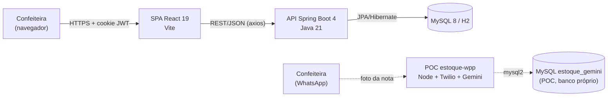

# 10.1 Visão geral e decisões de arquitetura

## Estilo arquitetural

O Doceterapia é uma aplicação web **cliente-servidor em três camadas**:

1. **SPA React** (apresentação), que roda no navegador.
2. **API REST monolítica em Spring Boot** (regras de negócio), organizada em camadas `controller → service → repository`.
3. **Banco relacional MySQL** (persistência). Em desenvolvimento, o banco é H2 em memória.

A integração com WhatsApp e IA fica **fora do monólito**. Hoje ela existe como uma prova de conceito (POC) em Node.js, em repositório próprio (`estoque-wpp`) e, no futuro, deve virar um orquestrador desenhado em arquitetura hexagonal (portas e adaptadores). Ver [10.8](08-integracoes.md).

## Stack e versões

| Camada | Tecnologia | Versão |
|---|---|---|
| Front-end | React / React DOM | ^19.2.8 |
| | Vite + @vitejs/plugin-react | ^8.2.2 / ^6.1.0 |
| | axios | ^1.20.0 |
| | lucide-react (ícones) | ^0.487.0 |
| | oxlint | ^1.79.0 |
| | Linguagem | JavaScript ES2020+ (JSX), ESM |
| Back-end | Java | 21 |
| | Spring Boot (Web, Data JPA, Validation, Security, Actuator) | 4.0.2 |
| | springdoc-openapi (Swagger UI) | 2.8.6 |
| | jjwt (api/impl/jackson) | 0.12.6 |
| | JUnit 5, Mockito, ArchUnit, Database Rider, JaCoCo | (Boot) / 1.4.1 / 1.44.0 / 0.8.11 |
| Banco | MySQL | 8.x (8.4 LTS na implantação de referência) |
| | H2 (desenvolvimento e testes) | gerenciada pelo Spring Boot |
| Integração (prova de conceito) | Node.js, Express, Twilio, @google/generative-ai (`gemini-2.5-flash`), mysql2 | 18+ / ^5.2.1 / ^6.0.0 / ^0.24.1 / ^3.22.2 |
| CI | GitHub Actions (Node 20, `npm ci` + `npm run build`) | — |
## Repositórios

| Repositório | Papel | Situação |
|---|---|---|
| `front-end` | SPA React | Ativo |
| `back-end` | API REST Spring Boot | Ativo |
| `banco-de-dados` | Script MySQL `scriptv4.sql`, modelo Workbench `.mwb` e imagem do DER | Ativo |
| `documentacao` | Esta documentação | Ativo |
| `estoque-wpp` | POC de entrada de estoque por WhatsApp (Twilio + Gemini) | Referência |

Os links estão em [13 - Links do projeto no Git](../13-links-git.md).

## Decisões de arquitetura (ADRs resumidos)

| # | Decisão | Motivo | Consequência |
|---|---|---|---|
| ADR-01 | Monólito REST em Spring Boot com camadas | Equipe pequena, domínio único e conhecimento prévio de Java | Deploy simples. Os módulos de domínio ficam separados por pacote/camada, não por serviço |
| ADR-02 | SPA React sem roteador, com navegação por estado em `App.jsx` | Poucas telas e uma única usuária | Simples, mas sem deep links nem histórico do navegador |
| ADR-03 | CSS puro com variáveis de tema e sem kit de UI (Tailwind removido no PR #1) | Controle visual e bundle menor | Mais CSS manual em `styles/` |
| ADR-04 | Autenticação JWT em **cookie HttpOnly** (`authToken`, SameSite=Strict), com fallback para `Authorization: Bearer` | Evita guardar o token em `localStorage` (XSS) | O front usa `withCredentials`, e o CORS precisa de origens explícitas |
| ADR-05 | DTOs de request e response com mappers manuais. Entidades nunca são expostas | Contrato estável e validação na borda | Mais código boilerplate (sem MapStruct nem Lombok) |
| ADR-06 | Contratos OpenAPI em interfaces `*ControllerOpenApi` separadas dos controllers | Controllers enxutos e documentação centralizada | Duas classes por recurso |
| ADR-07 | Máquinas de estado (Pedido, Produção) só nos services, com mapa de transições válidas | Regras de negócio em um só lugar e testáveis | O front não pode "pular" status |
| ADR-08 | Dinheiro em `BigDecimal` / `DECIMAL(10,2)` e status como enums `STRING` | Precisão e legibilidade no banco | — |
| ADR-09 | Snapshot de preço e custo no item do pedido | A margem histórica não muda quando o preço do produto muda | Colunas extras em `item_pedido` |
| ADR-10 | Integração WhatsApp/IA fora do core, com canal e provedor de IA intercambiáveis (hexagonal) | Isolar o risco (banimento, custo, mudanças de API) e permitir trocar Gemini por GPT ou Twilio por Cloud API/Baileys | O core precisa expor endpoints idempotentes de estoque e notificação |
| ADR-11 | Instalação local no computador da confeiteira (Windows 11) | Custo zero e uma única usuária | Disponibilidade limitada ao horário em que a máquina está ligada |

## Atributos de qualidade

| Atributo | Tática adotada |
|---|---|
| Usabilidade (RNF01, RNF07) | Fluxo em etapas, poucos campos, rótulos em PT-BR e testes com usuários |
| Acessibilidade (RNF02) | Zoom de 1× a 1,8× persistido, ARIA, HTML semântico e layout responsivo |
| Confiabilidade (RNF04) | Bean Validation, constraints `CHECK`/`UNIQUE`/FK e transições validadas |
| Segurança (RNF06) | BCrypt, JWT HMAC-SHA256, cookie HttpOnly e CORS restrito *(as rotas de domínio ainda estão abertas, ver [débitos](07-debitos-tecnicos.md))* |
| Manutenibilidade (RNF08) | Camadas, um pacote por responsabilidade, testes de service e convenções de código do time |
| Evolutividade (RNF09) | API REST desacoplada e integrações por portas e adaptadores |
