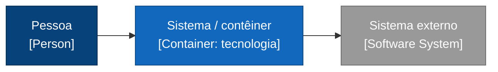
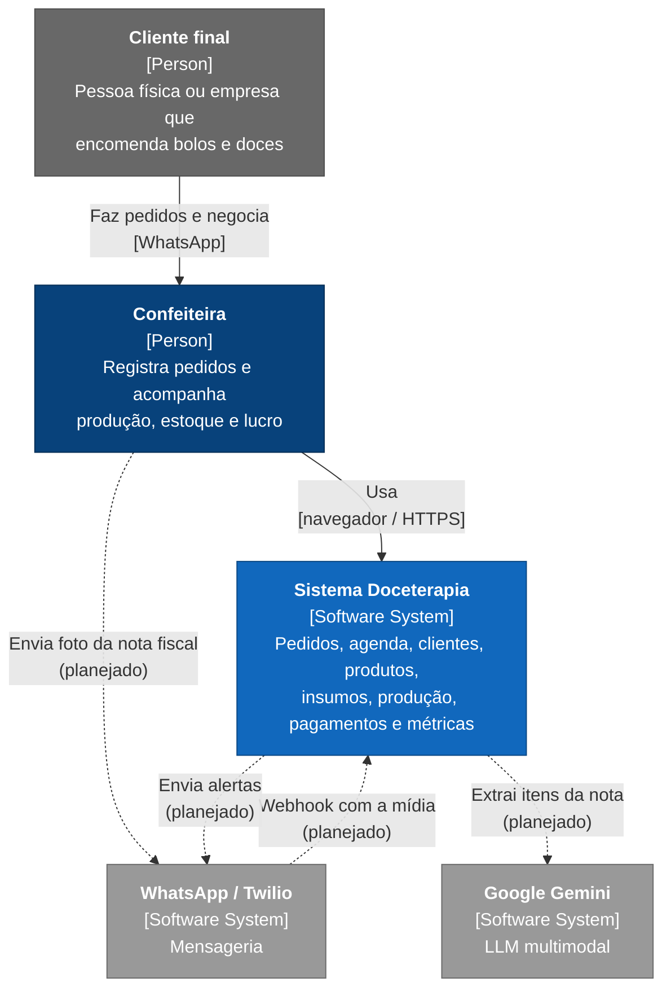
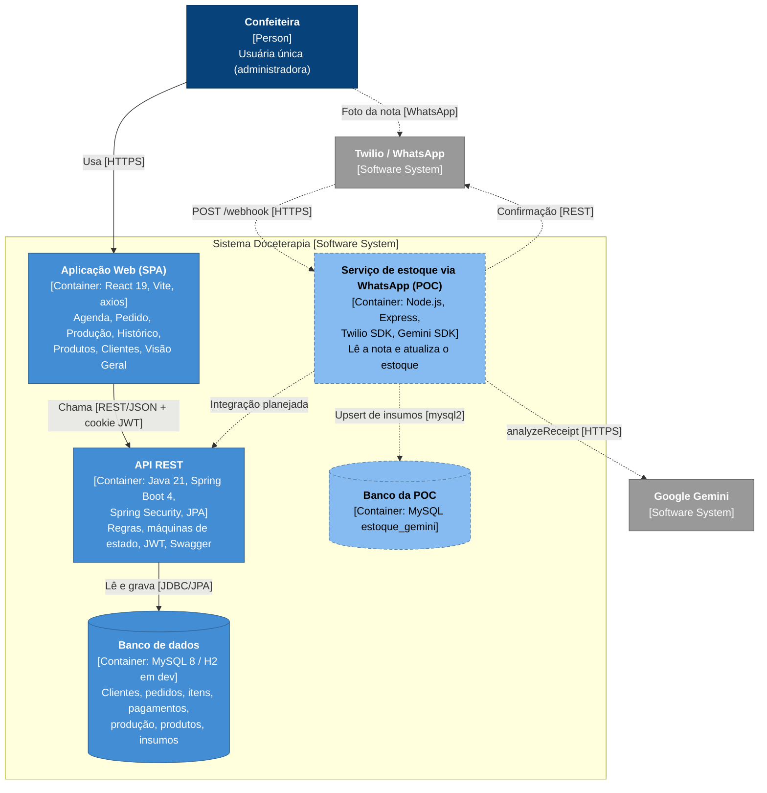
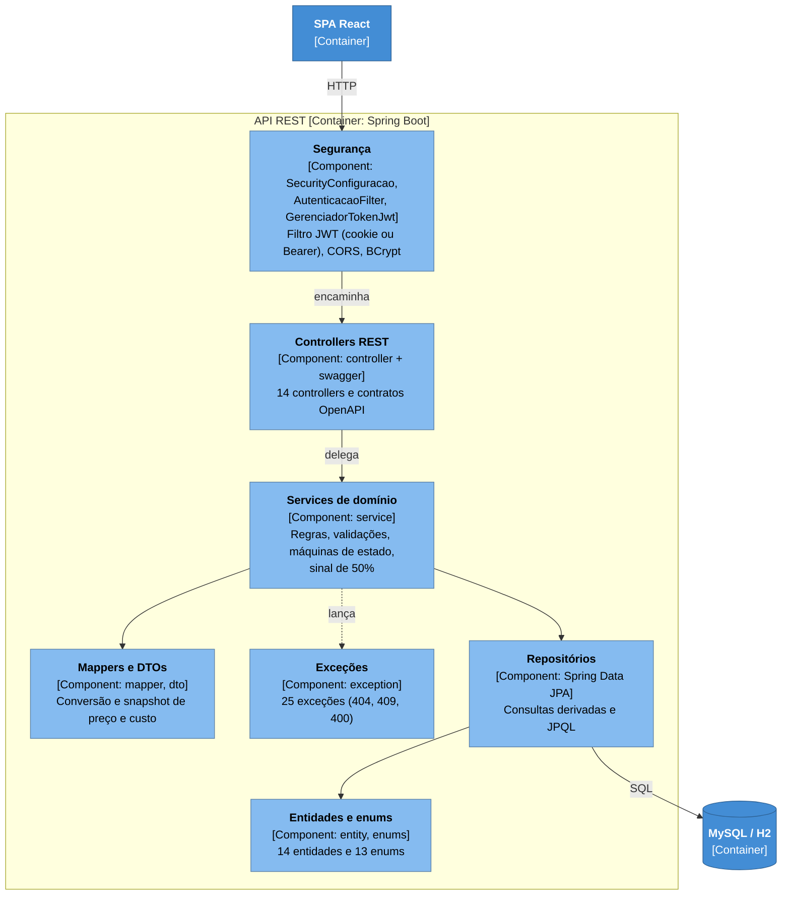
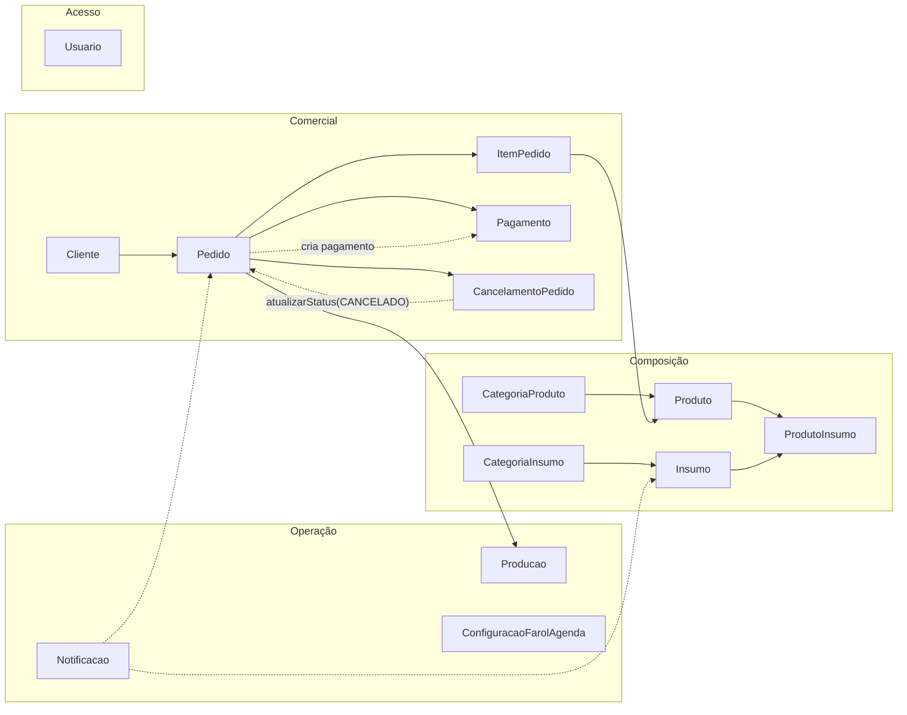
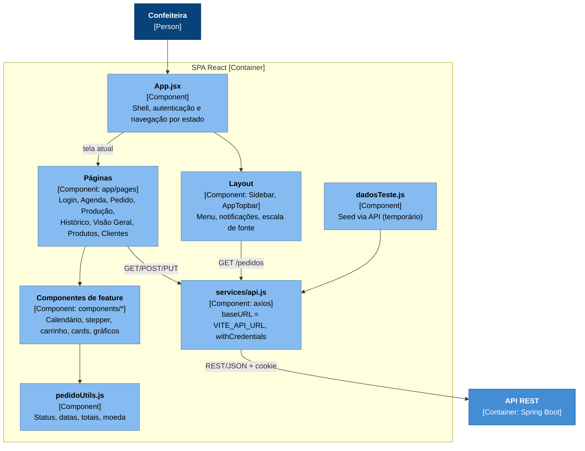
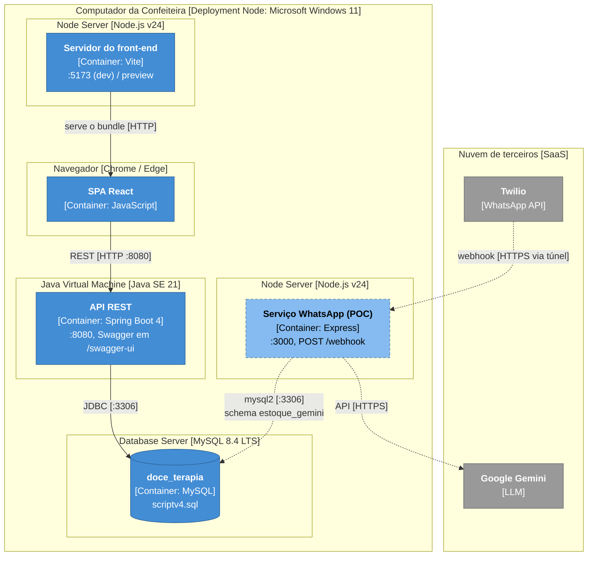
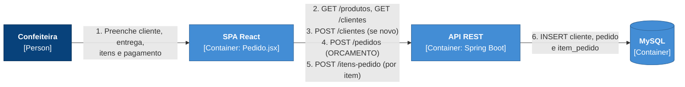

# 10.2 C4 Model

Diagramas nos quatro níveis do C4 (Contexto, Contêineres, Componentes e Código), mais os diagramas de Implantação e Dinâmico. O nível de código está em [10.3 UML](03-uml.md#1032-diagrama-de-classes-de-domínio).

> **Notação.** Os diagramas seguem a convenção do C4: cada elemento mostra o nome, o tipo e a tecnologia entre colchetes, além de uma descrição curta. São desenhados com `flowchart` do Mermaid porque o renderizador nativo de C4 (`C4Context`) ainda não faz um layout legível. Cores: azul-escuro para pessoas, azul para elementos do sistema, cinza para sistemas externos. A linha tracejada indica algo planejado ou fora do produto principal (POC).

## Nível 1 – Contexto do sistema

## Nível 2 – Contêineres

## Nível 3 – Componentes da API REST

Detalhamento por domínio (cada um tem controller, service, repository, mapper e DTOs próprios):

## Nível 3 – Componentes da SPA

## Implantação

Toda a solução roda no computador da confeiteira.

> Para receber webhooks do Twilio em uma máquina local, a porta 3000 precisa ser exposta publicamente (por exemplo, com um túnel). O diagrama mostra isso como um túnel HTTPS.
>
> Esta porta 3000 é o servidor de desenvolvimento Express da **prova de conceito** (repositório `estoque-wpp`, hoje referência apenas). Não confundir com a porta 3000 publicada pelo **front-end conteinerizado** do assistente de estoque (nginx + SPA), que é a atual (ver [10.9](09-assistente-visao-geral.md) e [10.13](13-assistente-implantacao.md)).

## Diagrama dinâmico – Registrar orçamento

