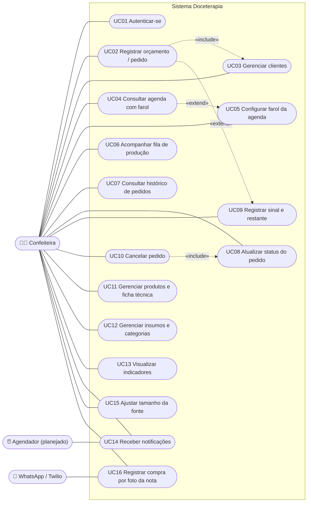
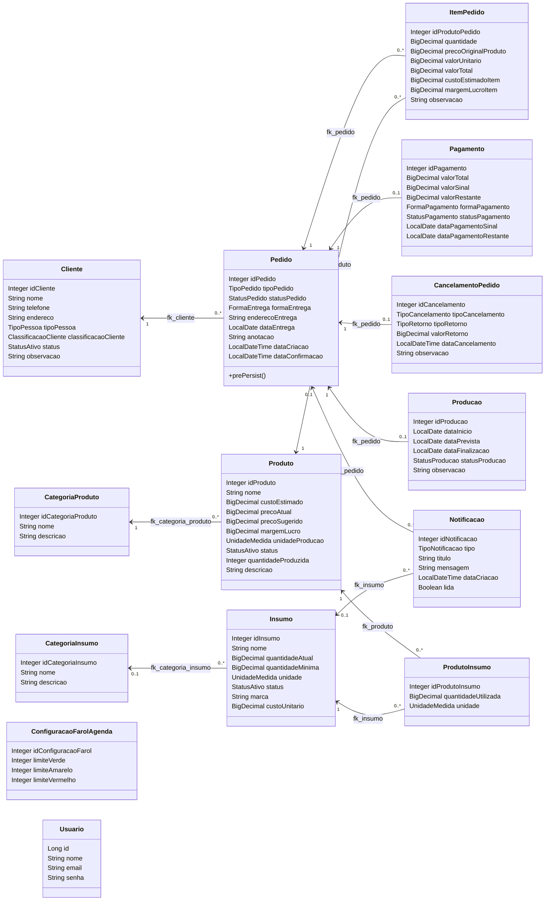
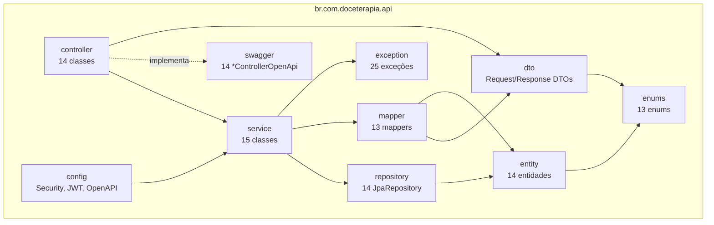
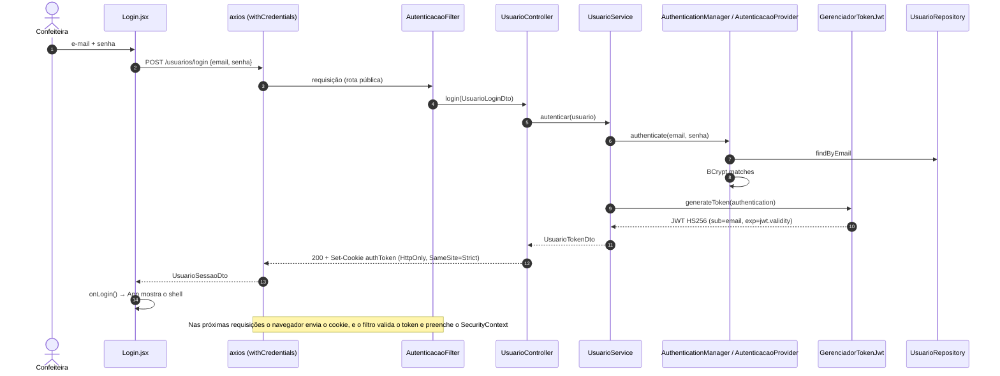
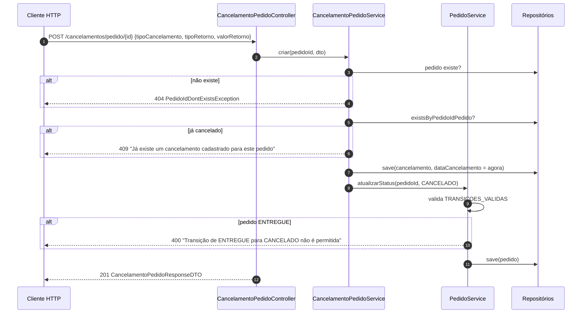
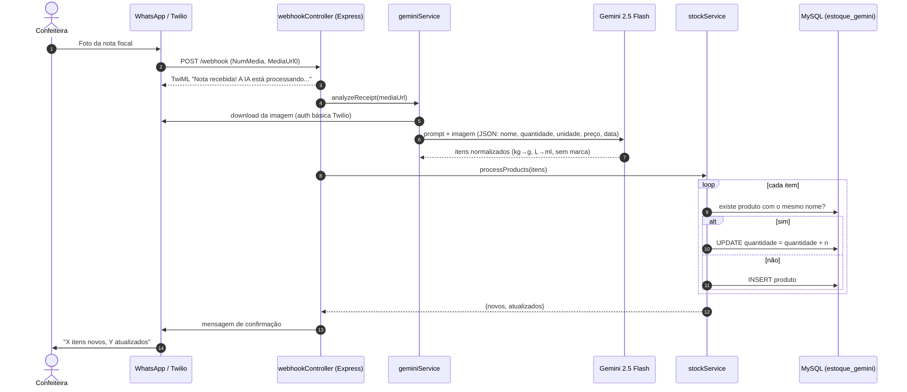
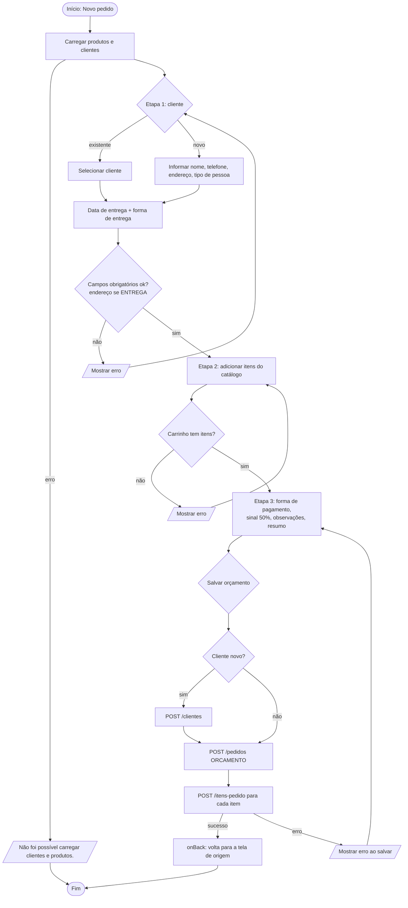

# 10.3 Diagramas UML

Os diagramas representam o código atual da API e da interface. Os diagramas de estado estão em [09 - Regras de negócio](../09-regras-de-negocio.md#95-máquinas-de-estado), e os de componentes e implantação estão no [C4 Model](02-c4-model.md).

## 10.3.1 Diagrama de casos de uso

| UC | Situação | Telas / endpoints |
|---|---|---|
| UC01 | ✅ API e tela prontas. O app abre já autenticado (protótipo) | `Login.jsx`, `POST /usuarios/login` |
| UC02 | ✅ | `Pedido.jsx`, `POST /pedidos`, `POST /itens-pedido` |
| UC03 | ✅ (sem exclusão no front) | `Clientes.jsx`, `/clientes` |
| UC04, UC05 | ✅ | `Agenda.jsx`, `/configuracao-farol` |
| UC06, UC07 | ✅ (somente leitura) | `Producao.jsx`, `HistoricoPedidos.jsx` |
| UC08, UC09, UC10 | 🟡 só na API | `PATCH /pedidos/{id}/status`, `/pagamentos/{id}/registrar-*`, `POST /cancelamentos/pedido/{id}` |
| UC11 | ✅ | `Produtos.jsx`, `/produtos`, `/produtos/{id}/insumos` |
| UC12 | 🟡 só na API | `/insumos`, `/categorias-insumo` |
| UC13 | ✅ | `VisaoGeral.jsx` |
| UC14 | 🟡 derivada dos pedidos na Topbar. `/notificacoes` existe | `AppTopbar.jsx` |
| UC15 | ✅ | `AppTopbar.jsx` |
| UC16 | 🧪 prova de conceito separada | Serviço de WhatsApp ([10.8](08-integracoes.md)) |

### Especificação resumida – UC02 Registrar orçamento

| Item | Descrição |
|---|---|
| Ator | Confeiteira |
| Pré-condição | Produtos cadastrados |
| Fluxo principal | 1. Clica em "Novo pedido". 2. Escolhe um cliente existente ou informa um novo. 3. Informa a data e a forma de entrega (endereço, se for entrega). 4. Adiciona itens pelo catálogo e ajusta as quantidades. 5. Escolhe a forma de pagamento e vê o total, o sinal (50%) e o restante. 6. Confirma, e o sistema grava o pedido como `ORCAMENTO` com seus itens. |
| Fluxos alternativos | 2a. Cliente novo: o sistema cria o cliente (`PADRAO`, `ATIVO`). 3a. Data no passado ou endereço ausente: o sistema mostra uma mensagem de validação. 4a. Carrinho vazio: o sistema impede o avanço |
| Pós-condição | O orçamento aparece na Agenda e no Histórico |
| Regras | RN01, RN02, RN07, RN08, RN12, RN13 |

## 10.3.2 Diagrama de classes de domínio

### Enumerações

Todas ficam em `enums/` e são persistidas como `@Enumerated(EnumType.STRING)`.

| Enum | Valores | Usado em |
|---|---|---|
| `StatusPedido` | `ORCAMENTO`, `AGUARDANDO_SINAL`, `ESPERANDO_FAZER`, `EM_PRODUCAO`, `AGUARDANDO_ENTREGA`, `ENTREGUE`, `CANCELADO` | `Pedido.statusPedido` |
| `StatusProducao` | `ESPERANDO_FAZER`, `EM_PRODUCAO`, `PRONTO_PARA_ENTREGA`, `FINALIZADO` | `Producao.statusProducao` |
| `StatusPagamento` | `AGUARDANDO_SINAL`, `AGUARDANDO_PAGAMENTO`, `PAGO_INTEGRAL` | `Pagamento.statusPagamento` |
| `TipoPedido` | `ORCAMENTO`, `PEDIDO_CONFIRMADO` | `Pedido.tipoPedido` |
| `FormaEntrega` | `ENTREGA`, `RETIRADA` | `Pedido.formaEntrega` |
| `FormaPagamento` | `PIX`, `DINHEIRO`, `CARTAO_CREDITO`, `CARTAO_DEBITO`, `TRANSFERENCIA` | `Pagamento.formaPagamento` |
| `TipoCancelamento` | `CLIENTE_DESISTIU`, `ERRO_PEDIDO`, `FALTA_INSUMO`, `OUTRO` | `CancelamentoPedido` |
| `TipoRetorno` | `CREDITO_CLIENTE`, `DEVOLUCAO`, `SEM_DEVOLUCAO` | `CancelamentoPedido` |
| `TipoNotificacao` | `ESTOQUE_BAIXO`, `DIA_LOTADO`, `RESUMO_INICIO_DIA`, `RESUMO_FIM_DIA`, `COMPRA_REGISTRADA`, `ALERTA_OPERACIONAL` (antes desta entrega: `ESTOQUE_BAIXO`, `PEDIDO_PROXIMO_ENTREGA`, `PAGAMENTO_PENDENTE`, `DIA_LOTADO`, `PEDIDO_ATRASADO`; os três sem geração foram removidos) | `Notificacao.tipo` |
| `TipoPessoa` | `FISICA`, `JURIDICA` | `Cliente.tipoPessoa` |
| `ClassificacaoCliente` | `PADRAO`, `FREQUENTE`, `ALTO_VOLUME` | `Cliente.classificacaoCliente` |
| `StatusAtivo` | `ATIVO`, `INATIVO` | `Cliente`, `Produto`, `Insumo` |
| `UnidadeMedida` | `KG`, `G`, `L`, `ML`, `UNIDADE` | `Produto`, `Insumo`, `ProdutoInsumo` |

## 10.3.3 Diagrama de pacotes (back-end)

## 10.3.4 Sequência – Login com cookie JWT

## 10.3.5 Sequência – Cancelar pedido

> O cancelamento é salvo **antes** de validar a transição do pedido, e nenhum service usa `@Transactional`. Por isso, cancelar um pedido `ENTREGUE` devolve 400, mas deixa o registro de `cancelamento_pedido` gravado. Ver [débitos técnicos](07-debitos-tecnicos.md).

## 10.3.6 Sequência – Entrada de estoque por nota fiscal (POC)

## 10.3.7 Atividade – Registrar pedido no front-end

