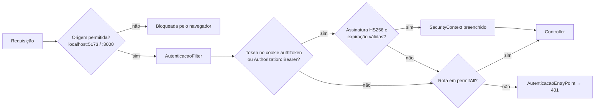

# 10.4 Back-end (API REST)

> Pacote raiz: `br.com.doceterapia.api` · Artefato: `br.com.doceterapia:api-doceterapia:0.0.1-SNAPSHOT`

## Camadas e responsabilidades

| Camada | Pacote | Responsabilidade | Convenção |
|---|---|---|---|
| Apresentação | `controller` | Recebe HTTP, valida com `@Valid` e delega ao service | Controllers enxutos que implementam `*ControllerOpenApi` |
| Contrato | `swagger` | Anotações OpenAPI (descrições em PT-BR) | Uma interface por controller |
| Negócio | `service` | Regras, validações e máquinas de estado | Injeção por construtor (exceto em classes legadas) |
| Mapeamento | `mapper`, `dto` | Conversão entre entidade e DTO e cálculos de snapshot | `*RequestDTO` / `*ResponseDTO` |
| Persistência | `repository`, `entity`, `enums` | Spring Data JPA e enums `@Enumerated(STRING)` | `BigDecimal` para valores monetários |
| Erros | `exception` | Exceções com `@ResponseStatus` | 404 `*DontExists`/`*NotFound`, 409 `*AlreadyExists`/`*Has*`, 400 transições |
| Infra | `config` | Segurança, JWT, CORS e OpenAPI | — |

## Catálogo de endpoints

Base: `http://localhost:8080` · Swagger UI: `/swagger-ui/index.html` · OpenAPI: `/v3/api-docs`

| Recurso | Método e caminho | Descrição | Sucesso |
|---|---|---|---|
| **Usuários** | `POST /usuarios` | Cria usuário (senha com BCrypt) | 201 |
| | `POST /usuarios/login` | Autentica e devolve o cookie `authToken` e `UsuarioSessaoDto` | 200 |
| | `POST /usuarios/logout` | Expira o cookie | 204 |
| | `GET /usuarios` | Lista usuários (exige autenticação, assim como `POST /usuarios/logout`) | 200 / 204 |
| **Clientes** | `GET /clientes` · `POST /clientes` · `PUT /clientes/{id}` · `DELETE /clientes/{id}` | CRUD. Telefone único | 200 · 201 · 200 · 204 |
| **Pedidos** | `GET /pedidos` | Lista com o cliente carregado (JOIN FETCH), ordenada por status e data de entrega | 200 |
| | `POST /pedidos` · `PUT /pedidos/{id}` · `DELETE /pedidos/{id}` | CRUD. A confirmação cria o pagamento | 201 · 200 · 204 |
| | `PATCH /pedidos/{id}/status?statusPedido=` | Transição validada | 200 |
| **Itens do pedido** | `GET /itens-pedido` · `POST` · `PUT /{id}` · `DELETE /{id}` | CRUD com cálculo de total e margem | 200 · 201 · 200 · 204 |
| **Produtos** | `GET /produtos` · `POST` · `PUT /{id}` · `DELETE /{id}` | CRUD | 200 · 201 · 200 · 204 |
| **Ficha técnica** | `GET /produtos/{produtoId}/insumos` · `POST` · `PUT /{id}` · `DELETE /{id}` | Insumos do produto (sem duplicar) | 200 · 201 · 200 · 204 |
| **Categorias de produto** | `GET /categorias-produto` · `POST` · `PUT /{id}` · `DELETE /{id}` | Nome único. Não exclui categoria com produtos | 200 · 201 · 200 · 204 |
| **Insumos** | `GET /insumos` · `POST` · `PUT /{id}` · `DELETE /{id}` | CRUD de estoque | 200 · 201 · 200 · 204 |
| **Categorias de insumo** | `GET /categorias-insumo` · `POST` · `PUT /{id}` · `DELETE /{id}` | Nome único. Não exclui categoria com insumos | 200 · 201 · 200 · 204 |
| **Produção** | `GET /producoes` · `GET /{id}` · `POST` · `PUT /{id}` · `DELETE /{id}` | Uma produção por pedido | 200 · 200 · 201 · 200 · 204 |
| | `PATCH /producoes/{id}/status?statusProducao=` | Transição linear | 200 |
| **Pagamentos** | `GET /pagamentos` · `GET /{id}` · `GET /pagamentos/pedido/{pedidoId}` | Consulta | 200 |
| | `PUT /pagamentos/{id}` | Atualização parcial (forma e datas) | 200 |
| | `PATCH /pagamentos/{id}/registrar-sinal` · `PATCH /{id}/registrar-restante` | Baixa do sinal e do restante | 200 |
| | `DELETE /pagamentos/{id}` | Remove | 204 |
| **Cancelamentos** | `POST /cancelamentos/pedido/{pedidoId}` | Cancela e muda o pedido para `CANCELADO` | 201 |
| | `GET /cancelamentos` · `GET /{id}` · `GET /cancelamentos/pedido/{pedidoId}` · `PUT /{id}` · `DELETE /{id}` | Consulta e manutenção | 200 · 204 |
| **Notificações** | `GET /notificacoes` · `GET /{id}` · `GET /notificacoes/nao-lidas` · `POST` · `PUT /{id}` · `DELETE /{id}` | CRUD | 200 · 201 · 204 |
| | `PATCH /notificacoes/{id}/marcar-lida` | Marca como lida | 200 |
| **Farol da agenda** | `GET /configuracao-farol` · `POST` · `PUT` | Configuração única | 200 · 201 · 200 |

### Validações de entrada (Bean Validation, mensagens em PT-BR)

| DTO | Regras principais |
|---|---|
| `PedidoRequestDTO` | `clienteId`, `tipoPedido` e `statusPedido` obrigatórios. `dataEntrega` obrigatória e `@FutureOrPresent`. `enderecoEntrega` com no máximo 255 caracteres |
| `ItemPedidoRequestDTO` | `fkProduto` e `fkPedido` obrigatórios. `quantidade` > 0. `valorUnitario` ≥ 0. `observacao` com no máximo 245 |
| `ClienteRequestDTO` | `nome`, `telefone` e `endereco` obrigatórios. `tipoPessoa`, `classificacaoCliente` e `status` obrigatórios |
| `ProdutoRequestDTO` | `fkCategoriaProduto` e `nome` (máx. 45) obrigatórios. Valores monetários ≥ 0 |
| `InsumoRequestDTO` | `fkCategoriaInsumo`, `nome`, `quantidadeAtual` ≥ 0, `quantidadeMinima` ≥ 0 e `unidade` obrigatórios |
| `ProdutoInsumoRequestDTO` | `fkInsumo` obrigatório, `quantidadeUtilizada` ≥ 0,001 e `unidade` obrigatória |
| `CancelamentoPedidoRequestDTO` | `tipoCancelamento` e `tipoRetorno` obrigatórios |
| `ConfiguracaoFarolRequestDTO` | Três limites ≥ 0. O service exige ordem crescente |
| `UsuarioCriacaoDto` | `nome` com 3 a 50 caracteres, `email` válido, `senha` com 6 a 20 caracteres |

## Segurança



| Aspecto | Implementação |
|---|---|
| Hash de senha | `BCryptPasswordEncoder` |
| Token | JWT HMAC-SHA256 (jjwt 0.12.6). Claims: `sub` (e-mail), `authorities` (vazio na prática, porque não há roles), `iat`, `exp` |
| Validade | `jwt.validity` (padrão de 3600 s) |
| Transporte | Cookie `authToken` HttpOnly, SameSite=Strict, `secure=false` (desenvolvimento) |
| Sessão | Stateless |
| Rotas públicas | Swagger, H2 console, Actuator, `POST /usuarios`, `/usuarios/login`, **e todas as rotas de domínio** (`/clientes/**`, `/pedidos/**`, `/produtos/**`, `/insumos/**`, …) |
| CORS | Origens `http://localhost:5173` e `http://localhost:3000`, com credenciais |

## Tratamento de erros

Não existe `@ControllerAdvice`. As exceções usam `@ResponseStatus`, e o corpo de erro padrão do Spring inclui a mensagem e os erros de binding (`spring.web.error.include-message=always`).

| HTTP | Exceções | Exemplos de mensagem |
|---|---|---|
| 404 | `PedidoIdDontExistsException`, `ClienteIdDontExistsException`, `ProdutoIdDontExistsException`, `InsumoIdDontExistsException`, `ProducaoNotFoundException`, `PagamentoIdDontExistsException`, `NotificacaoNotFoundException`, … | — |
| 409 | `TelefoneAlreadyExistsException`, `CategoriaProdutoNomeAlreadyExistsException`, `CategoriaProdutoHasProdutosException`, `CategoriaInsumoHasInsumosException`, `ProdutoInsumoDuplicateException`, `PedidoAlreadyHasProducaoException`, `CancelamentoAlreadyExistsException`, `ConfiguracaoFarolAlreadyExistsException` | "Telefone já está associado a outro cliente" |
| 400 | `StatusTransitionInvalidException`, `ProducaoStatusTransitionException`, `ProducaoFinalizedException`, `ResponseStatusException` (endereço obrigatório) | "Transição de ENTREGUE para CANCELADO não é permitida" |
| 500 | `IllegalStateException` (sinal e restante), `IllegalArgumentException` (farol), `RuntimeException` (ProdutoInsumo e ItemPedidoMapper) | Deveriam ser 400/404 ([débitos](07-debitos-tecnicos.md)) |

## Configuração

| Propriedade | Valor atual | Observação |
|---|---|---|
| `spring.datasource.url` | `jdbc:h2:mem:testdb` | H2 em memória |
| `spring.jpa.hibernate.ddl-auto` | `create-drop` | O schema é recriado a cada boot |
| `spring.h2.console.path` | `/h2-console` | — |
| `jwt.secret` | `${JWT_SECRET:<padrão>}` | **Tem valor padrão versionado.** Em produção, use `JWT_SECRET` |
| `jwt.validity` | `${JWT_VALIDITY:3600}` | Segundos |
| `springdoc.swagger-ui.with-credentials` | `true` | Envia o cookie pelo Swagger |

Para usar MySQL, sobrescreva `spring.datasource.url=jdbc:mysql://localhost:3306/doce_terapia` e as credenciais **por variáveis de ambiente**. A divisão em perfis `local` (H2 e valores de desenvolvimento) e `prod` (somente variáveis de ambiente, sem valores padrão) está planejada.

## Execução (Windows)

```powershell
cd back-end
$env:JAVA_HOME = "C:\caminho\para\jdk-21"   # obrigatório: o java do PATH pode ser 1.8
.\mvnw.cmd spring-boot:run                  # http://localhost:8080
.\mvnw.cmd test                             # testes unitários
.\mvnw.cmd clean verify                     # gate completo + JaCoCo (target/site/jacoco)
```

## Testes

| Tipo | Classes | Cobertura funcional |
|---|---|---|
| Unitários de service (JUnit 5 + Mockito) | `AutenticacaoServiceTest`, `UsuarioServiceTest`, `ClienteServiceTest`, `PedidoServiceTest`, `ItemPedidoServiceTest`, `ProdutoServiceTest`, `InsumoServiceTest`, `ProducaoServiceTest`, `PagamentoServiceTest`, `CancelamentoPedidoServiceTest`, `CategoriaProdutoServiceTest`, `CategoriaInsumoServiceTest` | CRUD, transições de estado, conflitos e validações. Cerca de 98 testes no total |
| Contexto | `ApiDoceterapiaApplicationTests` | Sobe o contexto Spring |
| Ausentes | `@WebMvcTest`, `@DataJpaTest`, ArchUnit, Database Rider | As dependências estão no `pom.xml`, mas não são usadas |
