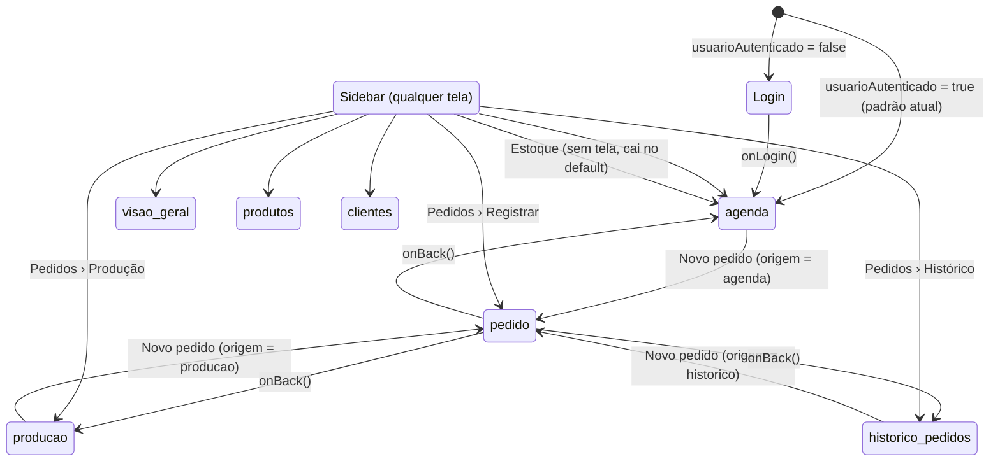
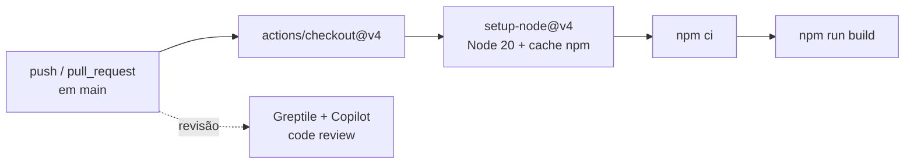

# 10.5 Front-end (SPA React)

> Repositório: `front-end` · Pacote: `telas-core` · React 19 + Vite 8, JavaScript (JSX), ESM

## Estrutura

```text
src/
├── main.jsx                 # createRoot + StrictMode + CSS globais
├── App.jsx                  # shell: autenticação e navegação por estado
├── app/pages/               # uma tela por arquivo
│   ├── Login.jsx  Agenda.jsx  Pedido.jsx  Producao.jsx
│   └── HistoricoPedidos.jsx  VisaoGeral.jsx  Produtos.jsx  Clientes.jsx
├── components/
│   ├── Sidebar.jsx  AppTopbar.jsx           # layout compartilhado
│   ├── agenda/      # CabecalhoAgenda, Calendario, ListaPedidos, ResumoAgenda, ConfiguracaoFarol
│   ├── pedido/      # EtapasPedido, CatalogoProdutos, Carrinho, Pagamento, ResumoPedido, AcoesPedido
│   ├── pedidos/     # PedidoProducaoCard, TabelaHistoricoPedidos, ResumoPedidos, PaginacaoPedidos, pedidoUtils.js
│   ├── produtos/    # ProdutoCard
│   ├── clientes/    # ClienteCard
│   └── visao-geral/ # CardResumo, EstoqueAtencao, PedidosAndamento, GraficoPedidos, GraficoFaturamento, ProdutosMaisPedidos
├── services/
│   ├── api.js        # axios: baseURL = VITE_API_URL || http://localhost:8080, withCredentials
│   └── dadosTeste.js # seed idempotente via API (temporário)
└── styles/          # theme.css (variáveis), orders.css, orders-workflow.css, fonts.css
```

## Navegação por estado (sem roteador)

`App.jsx` guarda `usuarioAutenticado`, `tela` e `origemPedido`. A `Sidebar` chama `navegar(id)`, e as telas chamam `criarPedido(origem)`. Ao concluir, o Pedido volta para a tela de origem.



## Telas

| Tela | Objetivo | Chamadas à API | Carregando / vazio / erro |
|---|---|---|---|
| Login | Autenticar | `POST /usuarios/login` | Spinner "Entrando...". Mensagem `role="alert"` |
| Agenda | Calendário mensal com farol e pedidos do dia | `GET /pedidos`, `/pagamentos`, `/itens-pedido`, `/produtos`, `/configuracao-farol`. `POST`/`PUT /configuracao-farol` | "Nenhum pedido para esta data." O erro da carga principal só vai para o console |
| Pedido | Registro em 3 etapas (cliente e entrega → itens → pagamento e resumo) | `GET /produtos`, `/clientes`. `POST /clientes`, `/pedidos`, `/itens-pedido` | "Salvando...". Erros por etapa |
| Produção | Fila de pedidos ativos por prazo e status, 6 por página | `GET /pedidos`, `/clientes`, `/itens-pedido`, `/produtos`, `/pagamentos` | Vazio por filtro. Erro com `role="alert"` |
| Histórico | Todos os pedidos com filtros de período, etapa e busca, 8 por página | idem | Vazio na tabela. Erro com `role="alert"` |
| Visão Geral | Lucro, custo, margem, dias lotados, estoque em atenção e gráficos | `GET /pedidos`, `/insumos`, `/produtos`, `/itens-pedido`, `/configuracao-farol` | Vazios por painel. Erro só no console |
| Produtos | Catálogo com categorias, preços e ficha técnica | `GET /produtos`, `/categorias-produto`, `/produtos/{id}/insumos`. `POST`/`PUT /produtos` | "Carregando insumos..." (`role="status"`). Vazio. Erro |
| Clientes | Catálogo com filtros (empresa, frequente, alto volume) e histórico | `GET /clientes`, `/pedidos`, `/itens-pedido`, `/produtos`. `POST`/`PUT /clientes` | Vazio. Erro |

## Componentes compartilhados

- **Sidebar:** menu principal (Visão Geral, Agenda, Estoque, Produtos, Pedidos › Registrar/Produção/Histórico, Clientes), com `aria-current="page"`.
- **AppTopbar:** data atual (pt-BR), sino de notificações e controle de fonte.
  - As notificações são geradas a partir de `GET /pedidos`, para pedidos com status de atenção (até 8, ordenados por entrega). As notificações lidas ficam em `localStorage` (`doceterapia-read-notifications`).
  - O controle de fonte aplica `--app-zoom` de 1 a 1,8 em passos de 0,2 e persiste em `localStorage` (`doceterapia-font-scale`).
- **`Modal` e `PageTop`:** exportados por `Produtos.jsx` e reutilizados em Clientes, Produção e Histórico.

## Acessibilidade

- Escala de fonte global persistida (resposta direta ao teste de usabilidade).
- HTML semântico (`main`, `nav`, `header`, `section`, `article`, `table`, `time`) e `label` associados aos campos.
- ARIA: `aria-label` em botões de ícone, `aria-expanded`/`aria-controls` em cards expansíveis, `role="alert"`/`role="status"` em mensagens e `role="dialog"`/`aria-modal` no modal do farol.
- Layout responsivo: a sidebar recolhe abaixo de 760 px, e o login se adapta abaixo de 480 px.
- Lacunas: o `Modal` genérico não tem `role="dialog"`, `index.html` usa `lang="en"` e não há auditoria formal de contraste WCAG.

## Build, qualidade e CI

| Tarefa | Comando |
|---|---|
| Instalar | `npm ci` |
| Desenvolvimento | `npm run dev` (http://localhost:5173) |
| Build | `npm run build` |
| Lint | `npm run lint` (oxlint: `react/rules-of-hooks`, `react/only-export-components`) |
| Testes | Ainda não configurados (Vitest + Testing Library planejados) |



Variável de ambiente: `VITE_API_URL` (padrão `http://localhost:8080`).
