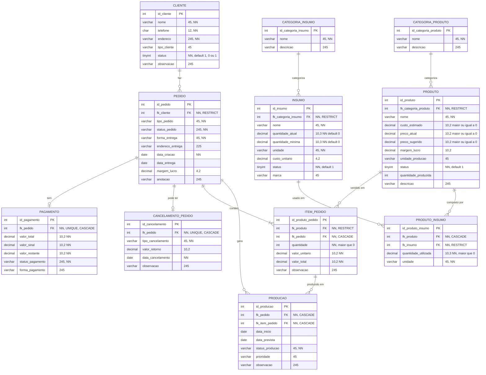
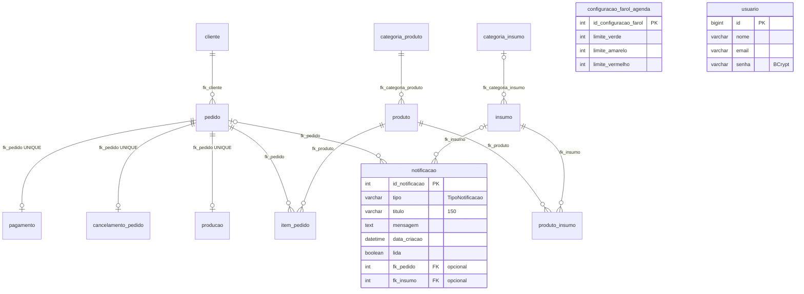

# 10.6 Banco de dados

> Script: `scriptv4.sql` (MySQL 8, schema `doce_terapia`) · Modelo: `modelagemv4.mwb` · Imagem: `doceTerapia.png`
>
> O modelo está na quarta versão. Ele é dividido em duas áreas: **Comercial** (cliente, pedido, pagamento, cancelamento) e **Composição** (produto, insumo, ficha técnica, item e produção).

## Modelo entidade-relacionamento (scriptv4.sql)

Políticas de integridade referencial:

- **RESTRICT** impede apagar cadastros mestres em uso: categoria → produto/insumo, cliente → pedido, produto → item, insumo → ficha técnica.
- **CASCADE** remove os dependentes do pedido (pagamento, cancelamento, itens e produção) e a ficha técnica do produto.
- Todas as FKs usam `ON UPDATE CASCADE`.

O script também insere dados de exemplo: categorias (Bolo, Docinhos, Torta; Secos, Laticínios…), clientes, produtos, insumos, ficha técnica, pedidos, pagamentos, itens, produção e cancelamento.

## Modelo efetivo da aplicação (entidades JPA)

Com `ddl-auto=create-drop`, a API gera o schema a partir das entidades. Esse modelo **difere** do `scriptv4.sql` e tem três tabelas a mais.

## Divergências entre o script SQL e as entidades JPA

| Tabela | `scriptv4.sql` | JPA (`entity/*`) | Ação sugerida |
|---|---|---|---|
| `cliente` | `tipo_cliente VARCHAR`, `status TINYINT`, `telefone CHAR(12)` | `tipoPessoa` e `classificacaoCliente` (enums), `status` ATIVO/INATIVO, telefone com até 20 caracteres | Criar `tipo_pessoa` e `classificacao_cliente`, `status VARCHAR`, telefone `VARCHAR(20)` UNIQUE |
| `pedido` | `data_criacao DATE`, `forma_entrega NOT NULL`, `margem_lucro` | `LocalDateTime`, forma de entrega opcional, sem margem, com `data_confirmacao` | Alinhar os tipos, remover `margem_lucro` e criar `data_confirmacao` |
| `item_pedido` | `quantidade INT` | `BigDecimal(10,3)` + `preco_original_produto`, `custo_estimado_item`, `margem_lucro_item` | Criar as colunas de snapshot e usar `DECIMAL(10,3)` |
| `pagamento` | sem datas | `data_pagamento_sinal`, `data_pagamento_restante` | Criar as colunas |
| `cancelamento_pedido` | `data_cancelamento DATE`, sem `tipo_retorno` | `LocalDateTime`, `tipoRetorno` | Criar `tipo_retorno` e usar `DATETIME` |
| `producao` | `fk_item_pedido`, `prioridade`, `fk_pedido` sem UNIQUE | 1:1 com o pedido, `data_finalizacao`, sem item nem prioridade | Decidir a granularidade (por pedido ou por item) e alinhar |
| `insumo` | `custo_unitario DECIMAL(4,2)`, categoria NOT NULL | `DECIMAL(10,4)`, categoria opcional | Aumentar a precisão (DECIMAL(4,2) só aceita até 99,99) |
| `produto`, `insumo` | `status TINYINT` | enum `STRING` | Padronizar |
| — | ausentes | `usuario`, `notificacao`, `configuracao_farol_agenda` | Adicionar ao script |

> Pela convenção do time, mudanças de schema devem atualizar `scriptv4.sql` e o `.mwb` ao mesmo tempo e manter as entidades alinhadas. O `schema.sql` dentro da API é uma terceira cópia do DDL, com diferenças próprias.
