# 10.7 Débitos técnicos e riscos

Levantamento feito na leitura do código em out/2026. Prioridade: **Alta** (segurança ou integridade), **Média** (comportamento incorreto ou retrabalho), **Baixa** (padronização).

| # | Débito | Onde | Impacto | Prioridade |
|---|---|---|---|---|
| D01 | Todas as rotas de domínio estão em `permitAll`. Só `GET /usuarios` e `POST /usuarios/logout` exigem autenticação | `config/SecurityConfiguracao` | Qualquer pessoa na rede lê e altera dados (viola o RNF06) | Alta |
| D02 | `jwt.secret` com valor padrão versionado. Não há perfis `local` e `prod` | `application.properties` | Tokens podem ser forjados se o padrão for usado fora do ambiente de desenvolvimento | Alta |
| D03 | Nenhum service usa `@Transactional`. O cancelamento grava o registro antes de validar a transição | `CancelamentoPedidoService.criar` | Cancelamento órfão para pedidos `ENTREGUE` | Alta |
| D04 | O front abre autenticado (`usuarioAutenticado = true`) e não tem logout | `App.jsx`, `AppTopbar.jsx` | A tela de login é ignorada | Alta |
| D05 | Pagamento criado com `valorTotal = 0` e sem recálculo pela soma dos itens | `PedidoService.atualizar`, `PagamentoService.criar` | Sinal e restante ficam zerados | Média |
| D06 | Status de pedido, pagamento e produção não se sincronizam | services | O mesmo pedido pode ficar com estados contraditórios | Média |
| D07 | O front filtra `statusPedido = AGUARDANDO_PAGAMENTO`, que não existe em `StatusPedido` | `HistoricoPedidos.jsx`, `AppTopbar.jsx` | Contadores sempre zerados | Média |
| D08 | Exceções genéricas (`IllegalStateException`, `IllegalArgumentException`, `RuntimeException`) viram HTTP 500. Não há `@ControllerAdvice` | `PagamentoService`, `ConfiguracaoFarolAgendaService`, `ProdutoInsumoService`, `ItemPedidoMapper` | Erros de validação aparecem como erro de servidor | Média |
| D09 | `ConfiguracaoFarolAgendaService.buscar` lança `NotificacaoNotFoundException` | service | Mensagem de erro enganosa | Baixa |
| D10 | O schema SQL diverge das entidades (mais de 15 pontos) | `scriptv4.sql` × `entity/*` × `schema.sql` | Falha ao apontar para o MySQL real com `validate` | Alta |
| D11 | Não há tela de Estoque. O item do menu cai na Agenda | `Sidebar.jsx`, `App.jsx` | US03 e RF05 não ficam acessíveis à usuária | Média |
| D12 | Botões sem ação: editar pedido no histórico, "+ Categoria", editar item no carrinho | front-end | Repete o problema principal do teste de usabilidade | Média |
| D13 | Não há baixa de estoque, verificação de viabilidade nem histórico de movimentações | back-end | RF06, RF08 e RF09 pendentes | Média |
| D14 | Front-end sem testes. Back-end sem testes de controller e de repositório. ArchUnit e Database Rider sem uso | ambos | Risco de regressão | Média |
| D15 | Injeção por campo (`@Autowired`) em classes legadas de usuário e segurança | `UsuarioService`, `AutenticacaoService`, `UsuarioController`, `SecurityConfiguracao` | Fora do padrão do time | Baixa |
| D16 | `UsuarioMapper` em `dto/` e DTOs com sufixo `Dto` | `dto/Usuario*` | Inconsistência de nomes | Baixa |
| D17 | Mapper acessa repositórios | `ItemPedidoMapper` | Mistura de camadas | Baixa |
| D18 | Listagens sem paginação no servidor | todos os `GET` de coleção | Desempenho com volume maior (RNF03) | Baixa |
| D19 | Mocks órfãos (`dadosAgenda.jsx`, `dadosPedido.jsx`, `Filtros.jsx`) e seed `dadosTeste.js` em produção | front-end | Código morto | Baixa |
| D20 | Cookie `secure=false` fixo | `UsuarioController.login` | Precisa ser `true` em HTTPS | Média |
| D21 | `@CrossOrigin` repetido nos controllers, além do CORS global | controllers | Configuração duplicada | Baixa |
| D22 | CI do front-end só faz build (sem lint e sem testes). Back-end sem CI | `ci.yml` | Qualidade não é verificada automaticamente | Média |
| D23 | `index.html` com `lang="en"` e `Modal` genérico sem `role="dialog"` | front-end | Acessibilidade para leitores de tela | Baixa |

## Roteiro de correção sugerido

```mermaid
flowchart LR
    subgraph F1["Fase 1 - Segurança e integridade"]
        direction TB
        D01["D01 rotas protegidas"]
        D02["D02 segredo e perfis"]
        D03["D03 transações"]
        D04["D04 login e logout"]
        D20["D20 cookie secure"]
    end
    subgraph F2["Fase 2 - Consistência de domínio"]
        direction TB
        D10["D10 alinhar schema"]
        D05["D05 total do pagamento"]
        D06["D06 sincronizar status"]
        D07["D07 status no front"]
        D08["D08 ControllerAdvice"]
    end
    subgraph F3["Fase 3 - Funcionalidades pendentes"]
        direction TB
        D11["D11 tela de Estoque"]
        D12["D12 ações de edição"]
        D13["D13 baixa e viabilidade"]
    end
    subgraph F4["Fase 4 - Qualidade"]
        direction TB
        D14["D14 testes"]
        D22["D22 CI"]
        DX["D09, D15-D19, D21, D23 padronização"]
    end
    F1 --> F2 --> F3 --> F4
```

> As correções devem seguir o fluxo do `AGENTS.md`: abrir uma change no OpenSpec, criar uma branch por demanda e rodar os gates de cada repositório.
