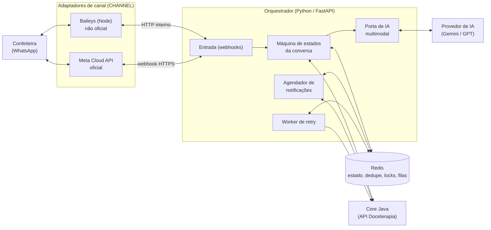
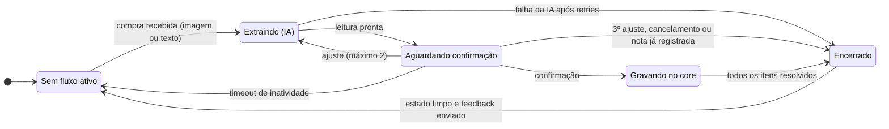

# 10.8 Integrações: WhatsApp e IA

A ideia é a confeiteira atualizar o estoque pelo próprio WhatsApp, mandando a foto da nota fiscal ou escrevendo a compra (por exemplo, "comprei 2 kg de farinha"), e receber alertas do sistema pelo mesmo canal. Esta seção descreve a prova de conceito que já existe, o que falta para ela virar parte do produto e a arquitetura planejada.

## 10.8.1 Estado atual: prova de conceito

Serviço Node.js independente (repositório `estoque-wpp`) que recebe a foto de uma nota fiscal pelo WhatsApp (Twilio), extrai os itens com o Gemini e faz upsert em um MySQL próprio.

| Item | Detalhe |
|---|---|
| Stack | Node 18+, Express ^5.2.1, twilio ^6.0.0, @google/generative-ai ^0.24.1 (`gemini-2.5-flash`), mysql2 ^3.22.2, Swagger (`/api-docs`) |
| Entrada | `POST /webhook` (Twilio). Valida `NumMedia`/`MediaUrl0` e responde com TwiML imediato |
| IA | Prompt que devolve JSON com nome, quantidade, unidade, preço e data. Converte kg → g e L → ml e remove marcas |
| Persistência | Tabela `produtos` no schema `estoque_gemini`. Se o nome já existe, soma a quantidade. Se não existe, insere |
| Saída | Mensagem com o total de itens novos e atualizados |
| Configuração | `PORT`, `DB_*`, `TWILIO_ACCOUNT_SID`, `TWILIO_AUTH_TOKEN`, `TWILIO_WHATSAPP_NUMBER`, `GEMINI_API_KEY` |
| Limitações | Não se integra ao core Java, grava direto em um banco paralelo, não pede confirmação da usuária, não tem idempotência, aceita qualquer remetente e não tem fila nem retry |

A sequência está em [10.3.6](03-uml.md#1036-sequência--entrada-de-estoque-por-nota-fiscal-poc).

## 10.8.2 Lacunas entre a prova de conceito e o produto

| Gap | Descrição | Prioridade |
|---|---|---|
| G1 | Envio outbound genérico (alertas e lembretes) | Quick win |
| G2 | API interna no serviço Node (`POST /internal/notifications`) para o core acionar | Quick win |
| G3 | Receber e classificar texto livre (PEDIDO, CONSULTA, OUTRO) | — |
| G4 | Modelo de dados para pedido vindo de texto | — |
| G5 | Consulta interna ao core | — |
| G6 | Controle de estoque estruturado no core | — |
| G7 | Trigger de alerta de estoque baixo | Quick win |
| G8 + G9 | Campo de agendamento de retirada ou entrega + scheduler de lembretes (`@Scheduled`) | Quick win |
| G10 | Log e idempotência de mensagens | — |
| G11 | Estratégia de comunicação entre o back-end e o serviço Node | — |

O volume estimado (cerca de 50 mensagens por dia) não justifica uma fila dedicada nesta fase.

## 10.8.3 Arquitetura alvo: assistente de estoque via WhatsApp

> Esta era a arquitetura **alvo** desta fase de planejamento. Ela foi implementada e está em revisão nos pull requests dos repositórios de produto; a entrega está documentada em [10.9–10.14](09-assistente-visao-geral.md). O texto abaixo é mantido como o planejamento que a originou.

Arquitetura **hexagonal**. O orquestrador define as portas (`ChannelPort`, porta de IA, porta do core), e os adaptadores podem ser trocados por configuração (`CHANNEL`, provedor de IA). Nada é gravado sem a confirmação explícita da confeiteira.

### Conversa como máquina de estados

### Endpoints que o core Java precisa expor

| # | Endpoint | Finalidade |
|---|---|---|
| 1 | `GET /v1/insumos` | Catálogo de insumos para o contexto da IA (id, nome, sinônimos e unidades) |
| 2 | `POST /v1/insumos` | Get-or-create de insumo novo (após aprovação) |
| 3 | `GET /v1/notas/{chave}/status` | Saber se a nota é inexistente, parcial ou completa |
| 4 | `POST /v1/estoque/movimentos` | Gravar **um** item por requisição, com `Idempotency-Key` |
| 5 | `GET /v1/notificacoes/agenda?de=&ate=` | Agenda de notificações a enviar |
| 6 | `POST /v1/notificacoes/{id}/confirmacao-envio` | Confirmação idempotente do envio |

### Regras e decisões principais

- **Regras:** nada é gravado sem confirmação. A entrada **soma** ao estoque e nunca sobrescreve. São permitidos no máximo 2 ajustes por leitura. Só o chat autorizado é atendido. Imagens e rascunhos não são guardados (LGPD).
- **Decisões:** uma única usuária, orquestrador em Python, canal intercambiável, Redis com AOF, LLM multimodal, sem MCP nesta versão, um request por item, idempotência e retry exponencial com jitter.
- **Riscos principais:**
  - Banimento no modo Baileys (aceito e documentado).
  - Alucinação da IA (mitigada pela confirmação humana).
  - Endpoints do core: eram inexistentes (bloqueante) nesta fase de planejamento; já foram implementados e estão em revisão (ver [10.9–10.14](09-assistente-visao-geral.md)).
  - Mudança de preço da Meta.

### Próximos passos

- Integrar a prova de conceito ao banco e à API principal.
- Trocar o modelo de IA de Gemini para GPT (sugestão de melhoria).
- Avaliar MCP para um assistente de IA em todo o sistema (desejável).
- Documentar a infraestrutura de produção da integração.
