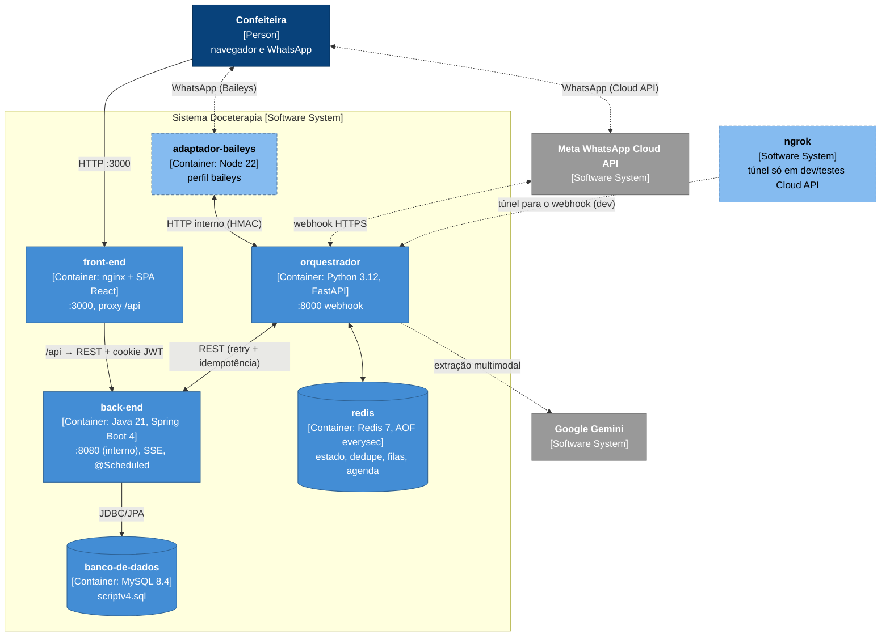
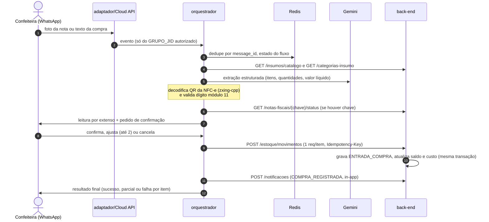
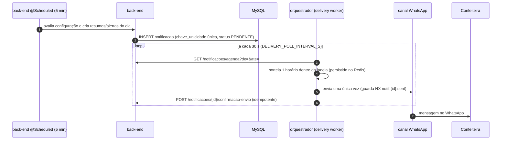
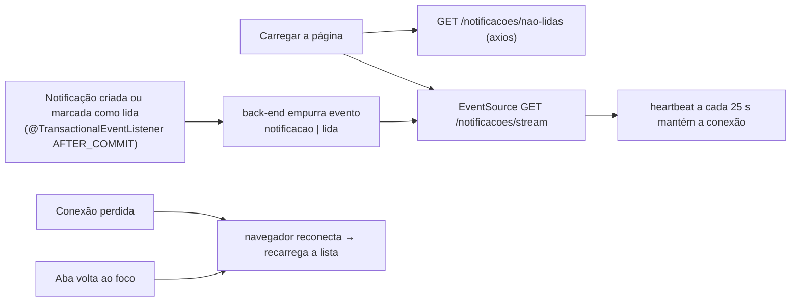

# 10.9 Assistente de estoque via WhatsApp — visão geral

> **Situação:** implementado e em revisão nos pull requests dos repositórios de produto; ainda não implantado em produção.

> Esta e as próximas seções (10.9 a 10.14) documentam o **assistente de estoque via WhatsApp**. Diferente da prova de conceito descrita em [10.8](08-integracoes.md), aqui está o que **existe** no código: o ledger de estoque e os endpoints idempotentes no core Java, as notificações de negócio com stream em tempo real, o orquestrador em Python, o adaptador Baileys em Node e o ambiente de contêineres do repositório `infra`. Itens ainda não validados estão marcados como **pendente** com o motivo.

## Repositórios da entrega

| Repositório | Papel | Imagem publicada (GHCR) |
|---|---|---|
| `back-end` | Core Java: ledger, endpoints de estoque/notas/notificações, jobs `@Scheduled`, stream SSE | `ghcr.io/projeto-doceterapia/back-end` |
| `front-end` | SPA: topbar de notificações pela API e modal de configuração | `ghcr.io/projeto-doceterapia/front-end` |
| `banco-de-dados` | `scriptv4.sql` com as novas tabelas, empacotado em imagem MySQL | `ghcr.io/projeto-doceterapia/banco-de-dados` |
| `assistente-whatsapp/orquestrador` | Serviço Python (FastAPI) da conversa de compra e da entrega de notificações | `ghcr.io/projeto-doceterapia/orquestrador` |
| `assistente-whatsapp/adaptador-baileys` | Adaptador Node/TS do canal Baileys | `ghcr.io/projeto-doceterapia/adaptador-baileys` |
| `infra` | Docker Compose: único repositório necessário para subir o sistema | — (consome as imagens acima) |

O orquestrador é o **único cliente** do core para o fluxo do assistente; ele nunca acessa o banco direto. O adaptador fala só com o orquestrador, por HTTP interno assinado com HMAC.

## Contêineres (arquitetura implantada)

- **Serviços-base** (sempre ativos): `banco-de-dados`, `back-end`, `front-end`, `redis`, `orquestrador`.
- **`adaptador-baileys`** só sobe no perfil `baileys`. No modo Cloud API (padrão do compose) ele não roda, e o orquestrador recebe o webhook da Meta.
- O compose publica **apenas** a porta do `front-end` (3000) e o webhook do orquestrador. Back-end, MySQL, Redis e adaptador ficam na rede interna.
- `ngrok` existe só no override local (`compose.local.yml`, perfil `tunnel`) para testes do webhook Cloud API em desenvolvimento, nunca em produção.

## Fluxo de uma compra (imagem ou texto)

A máquina de estados da conversa (IDLE → EXTRAINDO → AGUARDANDO CONFIRMAÇÃO → GRAVANDO → ENCERRADO) está em [10.8](08-integracoes.md#conversa-como-máquina-de-estados); o comportamento implementado segue esse fluxo de confirmação de compra.

## Fluxo de entrega das notificações

- Se a janela fechar antes do envio (máquina desligada além da janela), a notificação é reportada como `FALHA`, um `ALERTA_OPERACIONAL` é criado e a cópia **permanece visível no web app**.
- Alertas imediatos usam janela curta (`[agora, agora + 2 min]`), então com o poll padrão chegam ao WhatsApp em cerca de um minuto.

## Stream de notificações em tempo real (SSE)

O web app recebe atualizações instantâneas por Server-Sent Events, servidas pelo próprio back-end.

- O back-end mantém um **registro em memória** de `SseEmitter` abertos (sem timeout, heartbeat a cada 25 s). `spring.threads.virtual.enabled=true` evita prender uma thread de plataforma por conexão.
- **Exceção aprovada** à regra "HTTP só pela instância axios": o `EventSource` é usado apenas em `/notificacoes/stream`, porque o axios não consome streams. Fica no helper de serviço de notificações do front, não no componente.
- O registro em memória assume **uma única instância** do back-end (ver [10.14, débito do SSE/scheduler](14-assistente-rastreabilidade.md#débitos-técnicos-da-entrega)).
