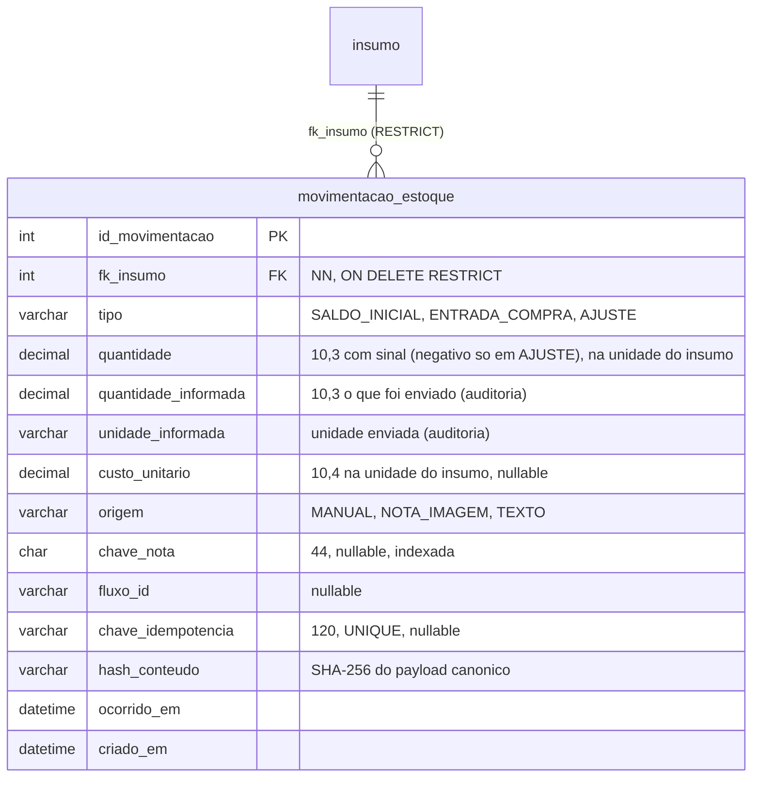

# 10.11 Assistente de estoque — modelo de dados

> **Situação:** implementado e em revisão nos pull requests dos repositórios de produto; ainda não implantado em produção.

O que o assistente de estoque acrescentou e alinhou no schema MySQL (`scriptv4.sql`) e nas entidades JPA, sobre o modelo descrito em [10.6](06-banco-de-dados.md). Dinheiro continua em `DECIMAL`, quantidades de estoque em `DECIMAL(10,3)` e custos em `DECIMAL(10,4)`.

## Nova tabela `movimentacao_estoque`

Ledger **append-only**: o saldo do insumo passa a ser a soma dos movimentos. Movimentos não são editados nem apagados pela API.

- `insumo.quantidade_atual` permanece, mas vira **cache** escrito só pelo serviço de movimentação, na mesma transação, com lock pessimista na linha do insumo. Leituras (`GET /insumos`, telas de Estoque e Visão Geral) não mudam.
- `chave_idempotencia` única garante que o retry nunca duplique; em corrida, o perdedor relê a linha e responde como duplicado.
- `hash_conteudo` distingue **duplicado** (mesma chave, mesmo conteúdo → 200) de **conflito** (mesma chave, conteúdo diferente → 409).

## Nova tabela `configuracao_notificacao`

Linha única com as preferências dos resumos e alertas, editáveis no web app (padrões confirmados com a proprietária):

| Coluna | Padrão | Significado |
|---|---|---|
| `inicio_expediente` | 08:00 | início do expediente |
| `fim_expediente` | 18:00 | fim do expediente |
| `dias_expediente` | seg–sáb | dias úteis |
| `horario_resumo_inicio` | 08:00 | horário do resumo de início do dia |
| `horario_resumo_fim` | 17:30 | horário do resumo de fim do dia |
| `dias_antecedencia` | 3 | horizonte do resumo de fim do dia |
| flags de habilitação | — | um liga/desliga por resumo e por alerta imediato |

Exposta por `GET`/`PUT /configuracao-notificacao`, que retorna 422 quando o fim não é posterior ao início ou um resumo cai fora do expediente.

## Novas colunas em `notificacao`

A tabela `notificacao` (que já existia nas entidades, mas não no `scriptv4.sql`) ganha campos de entrega, mantendo os campos e o CRUD atuais:

| Coluna | Valores | Papel |
|---|---|---|
| `chave_unicidade` | `UNIQUE` | dedupe das notificações criadas por job |
| `janela_inicio`, `janela_fim` | datetime | janela de envio para o sorteio do horário |
| `template_key` | texto | template de mensagem (fonte única `templates.yaml`) |
| `parametros` | JSON (texto) | parâmetros do template |
| `status_envio` | `PENDENTE`, `ENVIADA`, `FALHA`, `NAO_ENVIAR` | estado de entrega |
| `enviado_em` | datetime | quando foi enviada |
| `canal_message_id` | texto | id da mensagem no canal |

`COMPRA_REGISTRADA`, os alertas operacionais in-app e notificações criadas à mão nascem `NAO_ENVIAR` (só aparecem no web app).

## `insumo.nome_normalizado`

Coluna normalizada (trim, minúsculas, sem acentos, espaços colapsados) e indexada, usada para a busca do catálogo (`GET /insumos/catalogo?q=`, por palavra) e para o casamento do `POST /insumos/obter-ou-criar` (nome normalizado + unidade). Evita duplicar insumos quando o assistente cria um item.

## Alinhamento do script com as entidades

A mudança roda o back-end em MySQL com `ddl-auto=validate` no perfil `prod`, o que exige o `scriptv4.sql` idêntico às entidades. O alinhamento corrigiu, entre outros pontos já listados em [10.6](06-banco-de-dados.md#divergências-entre-o-script-sql-e-as-entidades-jpa):

- **`custo_unitario` do insumo:** de `DECIMAL(4,2)` (só até 99,99) para `DECIMAL(10,4)`.
- **Tabelas ausentes criadas:** `notificacao`, `configuracao_farol_agenda` e agora `movimentacao_estoque` e `configuracao_notificacao`.
- **`insumo.status`** padronizado como string (enum `StatusAtivo`), não mais `TINYINT`.
- **`insumo.fk_categoria_insumo`** e demais tipos divergentes alinhados ao que as entidades mapeiam.

> **Pendente:** o modelo `.mwb` do Workbench **ainda não foi atualizado** para as novas tabelas e colunas. Pela convenção do time, script e `.mwb` devem andar juntos; o `.mwb` fica como débito ([10.14](14-assistente-rastreabilidade.md)).
>
> **Pendente:** não há migrações versionadas. A imagem MySQL só roda `scriptv4.sql` em volume vazio; mudanças de schema após o primeiro boot não são aplicadas a dados existentes. Para esta entrega, recriar o volume é suficiente, pois nenhum ambiente tem dados reais ainda.
