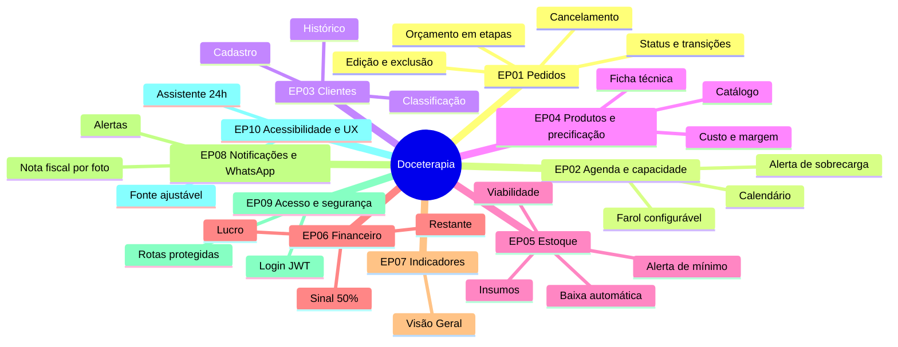
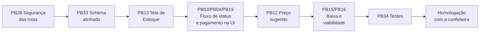

# 11. Product backlog

O backlog reúne tudo o que o sistema precisa entregar: histórias e requisitos ([05](05-requisitos.md)), melhorias do teste de usabilidade, débitos técnicos ([10.7](10-arquitetura/07-debitos-tecnicos.md)) e integrações planejadas ([10.8](10-arquitetura/08-integracoes.md)). A situação de cada item corresponde ao estado atual do código.

Prioridade (MoSCoW): **M** = Must, **S** = Should, **C** = Could, **W** = Won't (nesta versão).
Situação: ✅ concluído · 🟡 parcial · ⛔ a fazer · 🧪 prova de conceito.

## 11.1 Épicos

## 11.2 Itens do backlog

| ID | Épico | Item (história ou tarefa) | Origem | Prio. | Estimativa (Fib.) | Situação |
|---|---|---|---|---|---|---|
| PB01 | EP01 | Registrar orçamento em 3 etapas (cliente, itens, pagamento) | US01, RF01 | M | 8 | ✅ |
| PB02 | EP01 | Máquina de estados do pedido no back-end | RN06 | M | 5 | ✅ |
| PB03 | EP01 | Botões de avançar status e de confirmar orçamento no front-end | RF03, teste de usabilidade | M | 5 | ⛔ |
| PB04 | EP01 | Editar pedido pelo histórico (ícone de caneta funcionando) | RF03, RV05 | M | 5 | 🟡 |
| PB05 | EP01 | Excluir e cancelar pedido pela interface, com motivo e retorno | RF03, RN09 | S | 3 | 🟡 só API |
| PB06 | EP01 | Fila de produção e histórico com filtros e paginação | RV04 | M | 5 | ✅ |
| PB07 | EP02 | Agenda mensal com pedidos do dia | US02, RF02 | M | 5 | ✅ |
| PB08 | EP02 | Farol verde/amarelo/vermelho configurável | US04, RF12 | M | 3 | ✅ |
| PB09 | EP03 | CRUD de clientes, com telefone único e histórico de pedidos | RF04 | M | 3 | 🟡 sem exclusão no front |
| PB10 | EP04 | Catálogo de produtos por categoria | Escopo | M | 3 | ✅ |
| PB11 | EP04 | Ficha técnica (insumos por produto) editável no front | RN15 | S | 5 | 🟡 só leitura no front |
| PB12 | EP04 | Calcular custo estimado e preço sugerido a partir da ficha técnica | Principal dor da confeiteira | M | 8 | ⛔ |
| PB13 | EP05 | Tela de Estoque (CRUD de insumos e categorias) | US03, RF05 | M | 5 | ⛔ |
| PB14 | EP05 | Alerta de estoque baixo (Visão Geral e notificação `ESTOQUE_BAIXO`) | US03, RF07 | M | 3 | 🟡 |
| PB15 | EP05 | Baixa automática de insumos ao iniciar a produção | RF06, RN24 | S | 8 | ⛔ |
| PB16 | EP05 | Verificar viabilidade e bloquear a confirmação quando faltar insumo | RF08, RN23, CA03 | S | 8 | ⛔ |
| PB17 | EP05 | Histórico de movimentações de estoque | RF09 | C | 5 | ⛔ |
| PB18 | EP06 | Sinal de 50% e restante (API) | RN02–RN05 | M | 3 | ✅ |
| PB19 | EP06 | Propagar o total dos itens para o pagamento e registrar sinal e restante pela interface | D05 | M | 5 | ⛔ |
| PB20 | EP07 | Visão Geral: lucro, custo, margem, dias lotados e gráficos | RF13 | M | 8 | ✅ |
| PB21 | EP07 | Filtro de período na Visão Geral | Métricas | C | 3 | ⛔ |
| PB22 | EP08 | Notificações na topbar | UC14 | S | 3 | ✅ |
| PB23 | EP08 | Geração automática de notificações (`@Scheduled`) | G7–G9 | S | 5 | ⛔ |
| PB24 | EP08 | Entrada de estoque por foto da nota fiscal | CA01, CA02 | S | 13 | 🧪 |
| PB25 | EP08 | Assistente de estoque no WhatsApp com confirmação | Arquitetura alvo da integração | C | 21 | ⛔ |
| PB26 | EP08 | Envio de alertas pelo WhatsApp | Escopo | C | 8 | ⛔ |
| PB27 | EP09 | Login e logout com JWT em cookie | RNF06 | M | 5 | ✅ API · 🟡 front |
| PB28 | EP09 | Proteger as rotas de domínio e separar perfis `local` e `prod` | D01, D02 | M | 3 | ⛔ |
| PB29 | EP10 | Aumentar e reduzir fonte | Visita técnica | M | 2 | ✅ |
| PB30 | EP10 | Chatbot de ajuda 24h (árvore de decisão no Botpress) | CA06 | C | 8 | 🟡 desenho |
| PB31 | EP10 | Busca unificada de pedidos, clientes e produtos | RF10 | C | 5 | 🟡 |
| PB32 | — | Log de auditoria de pedidos | RF11 | C | 5 | ⛔ |
| PB33 | — | Alinhar `scriptv4.sql`, `.mwb` e entidades JPA | D10 | M | 5 | ⛔ |
| PB34 | — | Testes no front-end (Vitest) e de controller e repositório no back-end | D14 | S | 8 | ⛔ |
| PB35 | — | Programa de fidelidade (recompensas) | Estudo de fidelização | W | — | — |
| PB36 | — | Funil de vendas (Pipefy) | Alinhamento com a confeiteira | W | — | Descartado |

## 11.3 Ordem sugerida para as próximas entregas

