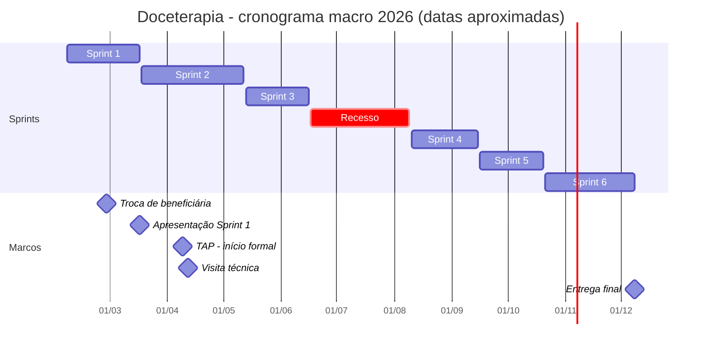

# 12. Ferramentas de planejamento

> Fontes: `Documento de Condução.docx` (v04), cronogramas de 6 sprints (`Cronograma_DoCeTerapia_6_Sprints_*.pptx`), `Status Report - Grupo 9 2SIS 2026.pptx`, `Planilha de Recursos.xlsx`, `MATRIZ_DEPENDENCIA.xlsx`, `EAP Doceterapia.pdf`, `GTD-Grupo9.docx`, `Restrospective SP1.docx`, `Atividade01.pdf`, atas de reunião e `AtividadeConsultoriav1Sprint5.docx`.

## 12.1 Equipe e papéis

| Integrante | Papel principal | Competências mais fortes (0–5) |
|---|---|---|
| Davi de Oliveira Domingues | Engenheiro de Back-end e Integração. Suplente do representante legal. Contato com a beneficiária | Back 5, Front 4, BD 4 |
| Davi Escudero Caproni | Engenheiro de Infraestrutura e DevOps | Infra 5, Back 4 |
| Felipe Queiroz de Lima | Administrador de Banco de Dados | BD 5, UX 4 |
| Gwen Raldes de Barros | Analista de Qualidade e Regras do Sistema | Back 4, BD 4, Infra 4, Negócios 4 |
| Maria Luiza Costa Góes | Designer de Interface e Front-end. Representante legal do grupo e líder | Front 5, UX 5, BD 5 |
| Pedro Guimarães Sakaue | Gerente de Produto e Documentação Técnica. Autor do TAP | Front 4, Back 4, Negócios 4, Gestão 4 |

O orientador de PI é o professor Alex. O grupo também atuou como PMO e consultor do Grupo 1 (projeto "Amor em Mechas"), com Matriz RACI e consultoria técnica na Sprint 5.

## 12.2 Capacidade (Planilha de Recursos)

- 8 h por semana planejadas por integrante, com 50% de disponibilidade, o que dá cerca de **4 h por semana efetivas por pessoa** e **24 h por semana para a equipe**.
- Riscos de disponibilidade mapeados: horários imprevisíveis no fim de semana (2 integrantes), alta demanda no trabalho (1) e trabalho aos fins de semana (1).
- A planilha também registra a área em que cada integrante quer se desenvolver, usada para distribuir tarefas fora da especialidade.

## 12.3 Cronograma (6 sprints)

Datas aproximadas, inferidas das atas, dos status reports e do TAP.

Plano por pacote de trabalho (cronograma oficial, versão "Sprint 4 atual"). A alocação considera 4 h por pessoa em cada tarefa.

| Área | Tarefa | Responsáveis | Duração | Alocação |
|---|---|---|---|---|
| Gestão | TAP, escopo e stakeholders | Equipe (6) | 1 sem. | 24 h |
| Gestão | EAP, cronograma, planejamento e controle | Equipe (6) | 1 sem. | 24 h |
| Gestão | Requisitos e critérios de aceite | Gwen, Malu | 2 sem. | 8 h |
| Design | Pesquisa da beneficiária e jornada | Malu, Gwen | 2 sem. | 8 h |
| Design | Arquitetura da informação e fluxos | Domingues, Pedro | 1 sem. | 8 h |
| Design | Protótipo, interface e acessibilidade | Malu, Felipe, Escudero | 2 sem. | 12 h |
| Software | APIs, banco e persistência | Felipe, Escudero, Domingues | 3 sem. | 12 h |
| Software | Serviços, regras de negócio e notificações | Felipe, Domingues | 3 sem. | 8 h |
| Software | Navegação, componentes e telas prioritárias | Pedro, Escudero | 3 sem. | 8 h |
| Integração | Front-end, back-end e banco | Equipe (6) | 2 sem. | 24 h |
| Integração | Twilio/WhatsApp, Gemini e chatbot | Escudero, Pedro | 2 sem. | 8 h |
| Infraestrutura | Ambiente, repositório, build e backup | Gwen, Pedro | 2 sem. | 8 h |
| Qualidade | Testes de integração e usabilidade | Escudero, Felipe, Domingues | 2 sem. | 8 h |
| Qualidade | Diagramas UML (classes, casos de uso, sequência) | Equipe (6) | 1 sem. | 24 h |
| Entrega | Homologação, manual, relatório e entrega | Equipe (6) | 2 sem. | 24 h |

## 12.4 Matriz de responsabilidades (derivada do cronograma)

R = responsável pela execução. A = aprovação em grupo, conforme o Documento de Condução ("qualquer alteração de entrega alheia passa pela aprovação do grupo").

| Pacote | Domingues | Escudero | Felipe | Gwen | Malu | Pedro |
|---|---|---|---|---|---|---|
| Gestão (TAP, EAP) | R | R | R | R | R | R |
| Requisitos e critérios de aceite | A | A | A | R | R | A |
| Pesquisa e UX | A | R | R | R | R | A |
| Arquitetura da informação | R | A | A | A | A | R |
| Back-end (APIs, serviços) | R | R | R | A | A | A |
| Front-end (telas) | A | R | A | A | A | R |
| Banco de dados | R | A | R | A | A | A |
| Integração WhatsApp / IA | A | R | A | A | A | R |
| Infraestrutura | A | A | A | R | A | R |
| Testes | R | R | R | R | A | A |
| Documentação | R | A | A | R | A | R |

## 12.5 EAP e matriz de dependências

A EAP (4 pacotes: Software, Design, Infraestrutura e Gestão) e o grafo de dependências entre os pacotes estão em [04 - Escopo](04-escopo.md#43-eap--estrutura-analítica-do-projeto).

## 12.6 Rituais (Documento de Condução, v04)

| Evento | Frequência | Formato | Regras |
|---|---|---|---|
| Daily | Seg–sex, até 15 min, entre 16:30 e 21:00 | Presencial | Pauta: o que fiz, o que vou fazer e impedimentos |
| Weekly | Sextas, 16:45–20:45 (até 4 h, com 30 min de intervalo) | Online (Discord) | Pauta colaborativa. Os primeiros 20 min são de checkpoint das tasks. Evidências do trabalho feito |
| Retrospective | Fim de cada sprint | — | Feedback individual de manutenção e de crescimento, rodada um a um e depois discussão em grupo |
| Ensaio de apresentação | Na semana anterior à apresentação da sprint | Presencial | Sem interrupções. Ajustes discutidos ao final |
| Extraordinária | Sob demanda | Variável | Combinada com antecedência |
| Atualização da beneficiária | Semanal | Grupo de WhatsApp | — |

Outras regras: 15 min de tolerância, atrasos registrados em ata, conflitos tratados com feedback individual e imediato, inovações discutidas em reunião antes de implementar, e um ou dois responsáveis por entregável. O planning poker foi suspenso na v04.

Histórico do Documento de Condução: v00 (06/02, criação) → v01 (regras) → v02 (capa) → v03 (assinaturas, 10/02) → v04 (revisão das regras, 31/03).

## 12.7 Ferramentas

| Ferramenta | Uso no projeto |
|---|---|
| **Microsoft Planner** | Backlog e acompanhamento diário das tasks, com checklists por tarefa |
| **Excel** | Matriz de rastreabilidade de requisitos, planilha de recursos, matriz de dependência, lista priorizada (`Livro.xlsx`) e respostas do teste de usabilidade |
| **PowerPoint** | Status report semanal, cronograma, critérios de aceite e proto-persona |
| **OneDrive** | Repositório único de documentos (Word, Excel, PDF) |
| **GitHub** (organização `projeto-doceterapia`) | Código, versionamento e PRs. Revisão automática com Copilot e Greptile. CI com GitHub Actions |
| **WhatsApp** | Comunicação rápida da equipe e com a beneficiária. Início e entrega de cada atividade são avisados no grupo |
| **Discord** | Reuniões online (canal "Sistemas de Informação sala 9") |
| **Figma** | Wireframe e protótipo de alta fidelidade (dependia de créditos) |
| **draw.io** | BPMN AS-IS e TO-BE e C4 Deployment |
| **MySQL Workbench** | Modelagem do banco (`modelagemv4.mwb`) |
| **Swagger / springdoc** | Documentação da API |
| **Formulário online** | Questionário do teste de usabilidade |
| **Canva** | Material visual e apresentações |
| **Botpress** | Protótipo da árvore de decisão do chatbot |
| **Pipefy** | Funil de vendas, avaliado e descartado na Semana 5 |
| **OpenSpec** | Specs e changes para desenvolvimento orientado a especificação (`openspec/`, inicializado) |
| **Mermaid** | Diagramas desta documentação, versionados como texto |

## 12.8 Status report semanal

Modelo: por frente (Plataforma, Back-end, Front-end, Negócios), com farol do projeto, progressos com responsável, pontos de atenção e próximos passos com responsável.

| Semana | Data | Destaques | Pontos de atenção |
|---|---|---|---|
| 1 | 24/03 | Métricas e KPIs, levantamento de dados com a beneficiária, proto-persona corrigida, programas de fidelidade, novos repositórios | Reunião com a beneficiária só depois da Páscoa |
| 2 | 31/03 | BD v2 e script, triggers de auditoria iniciados, Swagger, histórias de usuário, backlog no Planner | idem |
| 3 | 07/04 | RF/RNF, programação da visita, endpoints de cliente, login com ORM | Protótipo depende de créditos do Figma |
| 4 | 14/04 | Visita técnica, formulário e relatório de usabilidade, Pipefy e funil | — |
| 5 | 11/05 | Arquitetura de software, conceito da inovação, diagrama BD v2 | **Funil de vendas não faz sentido para a beneficiária** |
| 6 | 19/05 | BPMN com a solução, mapeamento de endpoints, tela de Login | — |
| 7 | 26/05 | Árvore de decisão do bot, documentação de endpoints | Ausências recorrentes |
| 8 | 02/06 | Arquitetura de sistemas, teste de usabilidade em CSV, métricas do dashboard | Ausências recorrentes |
| 9–10 | 10/08 e 17/08 | Arquitetura hexagonal da POC, serviço de notificações, 3 telas core, casos de uso, TAP | — |
| 11 | 24/08 | Primeira versão do TAP, EAP, mapeamento de telas | — |
| 12 | 31/08 | 3 telas core conectadas ao back-end, casos de uso, EAP | — |
| 13 | 28/09 | Critérios de aceitação, métricas de qualidade, diagramas de classes e de sequência, follow-up com a beneficiária | — |
| 14 | 05/10 | 2 novas telas conectadas, diagrama de contexto, especificação funcional | Sugestões: Gemini → GPT, MCP, aplicar a consultoria |

## 12.9 GTD (Getting Things Done)

Cada integrante destrinchou uma entrega em próximas ações concretas:

| Integrante | Projeto GTD |
|---|---|
| Davi Domingues | Integrar BD e back-end com o protótipo: mapear dados e entidades, endpoints, Swagger AS-IS, ajustar o diagrama do BD e codar entidades, endpoints e validações |
| Davi Escudero | Analytics: documento de métricas com justificativas para a usuária |
| Gwen Raldes | Testes unitários do back-end (meta ≥ 90% de cobertura nos services, Mockito + JUnit, TDD) e documentação |
| Maria Luiza | Árvore de decisão do bot (Agenda/farol, Estoque, Produtos, Pedidos: criar, sinal de 50%, alterar valor e status, cancelar, editar, registrar pagamento) e resultado da usabilidade em CSV |

## 12.10 Retrospectivas e lições aprendidas

| Manter | Melhorar | Ação |
|---|---|---|
| Alto comprometimento e prazos cumpridos | Comunicação e alinhamento em tempo real (entregas combinadas de última hora) | Checkpoints no WhatsApp durante a semana |
| Proatividade na troca de beneficiária (4 candidatas em 1 dia) | Aproveitamento do tempo de aula de PI | Atribuir responsáveis no início da sprint |
| Boa convivência e respeito | Weeklies longas e pouco objetivas | Encurtar a weekly e definir pauta prévia |
| — | Gestão de riscos | Ter plano B e C e usar o status report como controle de riscos |

A retrospectiva da Atividade 01 (formato Triste/Louco/Contente) gerou planos de ação por tema: dailies, weeklies, ensaios, planejamento, comunicação, saúde e bem-estar, convivência e profissionalismo.
