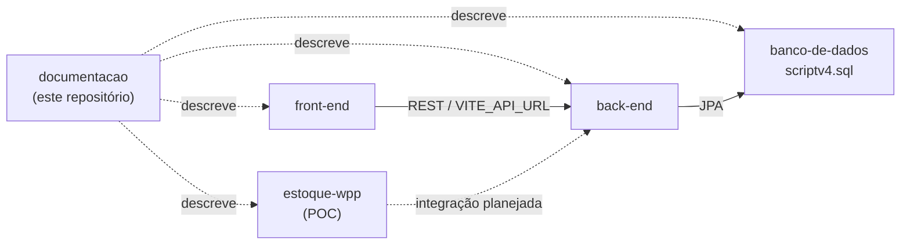

# 13. Links do projeto no Git

Todo o código fica na organização **[projeto-doceterapia](https://github.com/projeto-doceterapia)** no GitHub.

## 13.1 Repositórios

| Repositório | Link | Conteúdo |
|---|---|---|
| front-end | <https://github.com/projeto-doceterapia/front-end> | SPA React 19 + Vite |
| back-end | <https://github.com/projeto-doceterapia/back-end> | API REST Java 21 + Spring Boot 4 |
| banco-de-dados | <https://github.com/projeto-doceterapia/banco-de-dados> | Script MySQL (`scriptv4.sql`), modelo do Workbench e imagem do DER |
| documentacao | <https://github.com/projeto-doceterapia/documentacao> | Esta documentação |
| estoque-wpp | <https://github.com/projeto-doceterapia/estoque-wpp> | Prova de conceito de WhatsApp (Twilio + Gemini) |

Existe também um fork de referência fora da organização ([FelipeLima24/doceterapia](https://github.com/FelipeLima24/doceterapia)), que junta as pastas do projeto e usa outra stack no front-end (React 18 + TypeScript). Ele não é a base ativa.

## 13.2 Como os repositórios se relacionam



## 13.3 Marcos do histórico

**front-end** (14 PRs mesclados):

| PR | Entrega |
|---|---|
| — | Estrutura inicial e tela de login |
| #1 | Remoção do Tailwind e adoção de CSS convencional |
| #2, #3, #5 | Pipeline de CI, revisão por Copilot e status check do Greptile |
| #4 | Tela Visão Geral |
| #6, #7 | Telas Agenda e Pedido e refinamentos |
| #8 | Conexão entre front-end e back-end |
| #9, #10, #11 | Correções de acentuação, calendário e gráficos |
| #12 | Telas de Clientes e Produtos |
| #13 | Componentes de pedidos e telas de Produção e Histórico |
| #14 | Header global com notificações e fonte acessível |

**back-end:** protótipo e API v1 com Swagger → login e logout com JWT e cookies → testes de service → reorganização de pacotes e 13 enums → módulos Cliente, Pagamento, Pedido (máquina de estados), ItemPedido e CancelamentoPedido, Produção, Insumo, Produto e ProdutoInsumo, Notificação e Farol.

**banco-de-dados:** script e modelagem v2 → v3 → DER atualizado → **v4**.

**estoque-wpp:** código da POC e README.

## 13.4 Convenções de versionamento

- Branch por demanda a partir de `main`, nomeada `<tipo>/<nome-em-kebab-case>` (`feat/`, `fix/`, `docs/`, `refactor/`, `test/`, `chore/`). Ninguém commita direto em `main`.
- Commits em [Conventional Commits](https://www.conventionalcommits.org/) e em inglês, por exemplo `feat(pedido): add payment signal`. O histórico anterior está em PT-BR e não foi reescrito.
- Toda mudança entra por Pull Request (`gh pr create`), com Resumo, Testes executados, Pendências e link para a change do OpenSpec.
- CI do front-end: GitHub Actions (`npm ci` e `npm run build`) em pushes e PRs para `main`.

## 13.5 Clonar e executar tudo

```bash
git clone https://github.com/projeto-doceterapia/back-end.git
git clone https://github.com/projeto-doceterapia/front-end.git
git clone https://github.com/projeto-doceterapia/banco-de-dados.git

# Back-end (JDK 21): http://localhost:8080 (Swagger em /swagger-ui/index.html)
cd back-end && ./mvnw spring-boot:run        # Windows: .\mvnw.cmd spring-boot:run

# Front-end (Node 20+): http://localhost:5173
cd ../front-end && npm ci && npm run dev

# Banco MySQL (opcional; sem ele a API usa H2 em memória)
mysql -u <usuario> -p < ../banco-de-dados/scriptv4.sql
```
